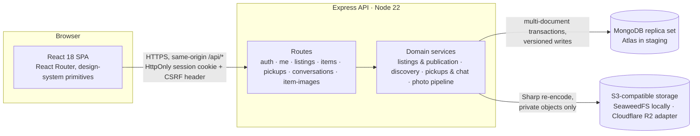

# Move-Out Marketplace

**Pass on what you can't take with you. Find what you need nearby.**

When people move out they throw away furniture, kitchenware and lamps that a neighbor would happily pick up. Move-Out Marketplace is a full-stack web app for exactly that handoff:

- **Givers** list items with photos, a pickup area and a pickup deadline.
- **Neighbors** browse by metro, city and neighborhood, request a pickup time and coordinate in a private chat.
- **Handed over in person.** Givers and neighbors settle the details in a private chat; street addresses never appear on the site.

The project started from the IBM Full-Stack capstone ("GiftLink") and was rebuilt into an item-first marketplace. The rebuild added real accounts, transactional pickups, a private photo pipeline, and accessibility and browser test coverage.

> Status: a portfolio demo running on free hosting tiers. A public launch is not approved; the remaining launch items are tracked in [production readiness](docs/production-readiness.md).

## Try the live demo

**[fullstack-capstone-project-flax.vercel.app](https://fullstack-capstone-project-flax.vercel.app)**

The demo runs on free tiers (Vercel, MongoDB Atlas and Cloudflare R2), so the first request after a quiet period can take a few seconds. Treat everything you enter as public demo data that may be reset at any time. Register with a made-up address such as `giver@example.com` and a throwaway password of at least 12 characters.

The full handoff needs two accounts, so use a normal browser window and a private (incognito) window side by side:

1. **Window A, the giver.** Register, open **Donate → Create Listing**, add a name, a photo or two, a pickup area and a deadline, then **Publish**.
2. **Window B, the neighbor.** Without signing in, open **Find**, choose the same metro area and open the listing. Click **Request pickup**, choose **Register Here** on the sign-in page to create a second account, then pick a time inside the pickup window and send the request.
3. **Window A.** Go to **Donate → Incoming requests** and choose **Accept pickup**. The item is now reserved for everyone else.
4. **Both windows.** Open the request with **Open conversation** and exchange a few messages in the private chat.
5. **Optional.** Cancel the request from window B, or withdraw the listing from **Manage listing** in window A and watch it disappear from Find.

## What you can do

| Giver (Donate) | Neighbor (Find) |
| --- | --- |
| Create a listing: name, type, condition, description, up to 5 photos, pickup area and deadline | Browse anonymously by **metro area → city → neighborhood** |
| Publish it, then edit it in place or withdraw it from **Manage listing** | Search and filter (category, item type, condition, sort); results update as you type |
| See the number of open requests on each listing card | Open a listing with its photo gallery and share link |
| Accept or decline requests; accepting reserves the item | Sign in only when requesting a pickup date and time |
| Chat privately with each requester | Chat with the giver, or cancel the request |

A pickup request never reserves an item by itself. The giver accepts one appointment per item, and other requests stay pending until the appointment is released.

## Architecture



- **Frontend (`giftlink-frontend`)**: a Create React App SPA. Pages are grouped by journey: Find, Donate (My Listings), and Pickups. Shared form, feedback and unsaved-changes guards live in `src/forms` and `src/design-system`.
- **API (`giftlink-backend`)**: Express with thin routes and domain services (`services/`).
  - It runs as a long-lived server locally and on Vercel's Express runtime in staging (`vercel.json`).
  - It refuses to start against a standalone MongoDB, because every coordinated write uses a transaction.
- **Data**: MongoDB holds users, hashed sessions, listings, pickup requests, messages and photo metadata. Photo bytes live in private object storage and are only ever served back through authorized API routes.
- **Staged rollout**: environment flags, all off by default, turn on each item-first capability separately:
  - `OWNER_LISTINGS_ENABLED`
  - `OWNER_LISTING_PHOTOS_ENABLED`
  - `OWNER_LISTING_PICKUPS_ENABLED`
  - `OWNER_LISTING_PUBLICATION_ENABLED`

  The earlier plan-based model ("move-out plans" holding items) keeps working alongside them.

### How a pickup flows

1. The giver saves a listing, which is validated server-side and given a pickup deadline. Uploaded photos are processed and stored privately, then the giver publishes.
2. Discovery queries only published, unexpired, unreserved listings in the selected metro, and returns no owner identifiers.
3. A neighbor proposes a local date and time inside the listing's pickup window. The server re-checks the window and that the item is still available.
4. When the giver accepts, a transaction marks the request accepted. A unique partial index guarantees at most one accepted pickup per item.
5. Requester and giver exchange plain-text messages that only those two participants can read. Declining, cancelling or withdrawing closes the request and leaves the history read-only.

## Engineering highlights

- **Accounts and sessions**:
  - Passwords are hashed with bcrypt.
  - Sessions are server-side, stored hashed, and carried in a `__Host-` HttpOnly, Secure, SameSite=Lax cookie.
  - Every write requires a matching `Origin` and an `X-CSRF-Protection` header.
  - Requests are rate-limited.
- **Consistency under concurrency**:
  - Items and requests carry versions, so stale edits fail with `409` instead of overwriting newer data.
  - An item-level coordination fence keeps edits, photos, publication and pickups consistent with each other.
  - A published listing's pickup place and dates are locked while requests are open.
- **Time zones done carefully**:
  - Deadlines mean "the end of this local date" in the listing's time zone, computed with Temporal.
  - The time zone comes from the metro or the owner's browser, so owners never pick one.
  - Appointments are validated server-side, including daylight-saving gaps.
- **Private photo pipeline**:
  - Photos are resized in the browser before upload.
  - The server validates them strictly: format, dimensions and decompression-bomb limits.
  - Sharp re-encodes every photo, which strips metadata.
  - Per-owner quotas apply, and recovery tooling cleans up interrupted uploads.
  - Public galleries exist only for published listings.
- **Privacy by design**: listings show general locations only (metro, city, neighborhood), with no GPS, street addresses or contact fields. Tests assert that public responses never leak owner or participant IDs.
- **Accessibility**: browser tests run axe-core WCAG 2.1 A/AA checks on each screen. They also check keyboard paths and reflow at 320 px and 200% text.

## Tech stack

| Layer | Technology |
| --- | --- |
| Frontend | React 18, React Router 6, Create React App, Jest + React Testing Library |
| API | Node.js 22, Express 4, express-validator, express-rate-limit, pino logging |
| Data | MongoDB 8 (replica set; MongoDB Atlas in staging), official Node driver |
| Photos | Sharp, AWS SDK v3 S3 client; SeaweedFS locally, Cloudflare R2 adapter for hosted use |
| Time | `@js-temporal/polyfill` |
| Testing | Node test runner + Mocha/Supertest against disposable Docker MongoDB/SeaweedFS; Playwright (desktop + mobile Chromium over HTTPS) with axe-core |
| CI / hosting | GitHub Actions; Vercel for the frontend and API staging |

## Run it locally

Prerequisites: Node.js 22, Docker Desktop running Linux containers, and Chrome or Edge.

```bash
npm --prefix giftlink-backend ci
npm --prefix giftlink-frontend ci
npm --prefix e2e ci
node local/manual-mvp.cjs --approve-disposable-local
```

The launcher does three things:

- Starts a **disposable** MongoDB replica set and SeaweedFS in Docker.
- Starts the API and the React dev server behind a local HTTPS gateway with all item-first features enabled.
- Prints `Open: https://127.0.0.1:<port>/app/listings`.

Accept the local certificate warning. To try both sides, use a normal window for the giver and a private window for the neighbor. Press **Ctrl+C** to stop; the containers and data are removed.

Step-by-step Windows instructions and a two-account walkthrough are in [Windows local MVP acceptance](docs/windows-local-mvp-acceptance.md). Manual database setup, environment variables and deployment are covered in the [operations runbook](docs/operations-runbook.md).

## Tests and CI

| Suite | Command | What it covers |
| --- | --- | --- |
| Backend | `npm --prefix giftlink-backend test` | API contracts, auth, listings, discovery, pickups, chat and the photo pipeline, against real MongoDB/SeaweedFS in Docker |
| Frontend | `npm --prefix giftlink-frontend test -- --watchAll=false` | Component and flow tests for forms, discovery, listings, pickups and the conversation UI |
| Browser | `npm --prefix e2e test` | End-to-end journeys in Chromium over HTTPS (desktop and mobile), with accessibility checks |

On every pull request, GitHub Actions runs:

- backend lint and tests;
- frontend tests and a production build;
- the isolated browser suite;
- a Windows smoke test of the local launcher.

## Repository layout

```
giftlink-frontend/   React SPA (components by journey, design system, API clients)
giftlink-backend/    Express API: routes/, services/, middleware/, test/, util/ (index and maintenance tools)
e2e/                 Playwright suites and the disposable local environment (local.cjs)
local/               One-command local launcher (manual-mvp.cjs)
deployment/          Staging preparation and diagnostics scripts
docs/                Architecture notes, runbooks, design system and milestone records
```

## Further reading

- [Milestone history](docs/milestone-history.md): the detailed engineering log of each milestone, kept from the previous README.
- [Item-first architecture](docs/milestone-6.6-ux2a-item-first-architecture.md) and [photo architecture](docs/milestone-6.5-photo-architecture.md)
- [Design system](docs/design-system.md)
- [Production readiness](docs/production-readiness.md), [operations runbook](docs/operations-runbook.md) and [photo operations runbook](docs/photo-operations-runbook.md)

## License and provenance

Derived from the IBM Developer Skills Network full-stack capstone, with the original [Apache 2.0 license](LICENSE) and attribution retained. Check the license of individual assets before redistributing them.
