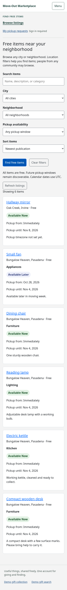
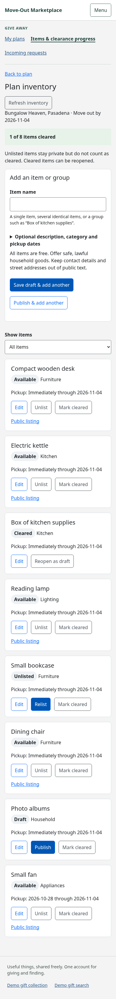
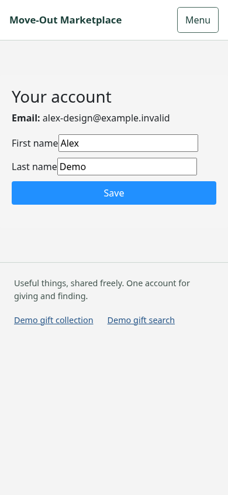

# Local UI audit evidence

These are **unaltered screenshots of the existing UI**, not redesign mockups or
live staging captures. Baseline `e6e93af30d3ef2e6c26f1a88a7de7bacebada97a`,
captured 2026-10-25. See the [audit](../../milestone-6.1-design-audit.md) for the
findings, proposed flows, implementation boundaries and owner decisions.

The production frontend build ran behind the existing loopback HTTPS fixture
with a verified disposable MongoDB replica set. All accounts, notes and listing
data are synthetic; `.invalid` email addresses are intentional. No credentials,
cookies, storage state or real user data are included. Random loopback ports/IDs
are incidental. Appointment history uses the fixture clock for completed/no-show
examples; this is not a record of real pickups.

Viewport labels: desktop 1440×1000, tablet 768×1024, mobile 390×844. Full-page
captures extend beyond those viewport heights; they do **not** imply that the
whole page fits on a phone. Pages were scrolled to the top before full capture
to avoid fixed-position screenshot artifacts. No image editing was performed.

## Representative comparisons

| Mobile discovery: results below filters | Mobile inventory: items below add form | Account: inconsistent controls |
| --- | --- | --- |
|  |  |  |

## Capture index

| Screenshot | Evidence / relevant finding |
| --- | --- |
| [Desktop home](desktop-home.png) | Existing green/blue two-journey identity to preserve; C5 is a preference, not a reproduced defect. |
| [Mobile home](mobile-home.png) | Both journey CTAs remain within the captured initial 844px viewport; do not invent a hidden receiver CTA problem. |
| [Mobile discovery](mobile-discovery.png) | First card at document y≈1124px; B5. “Available Now” is a date window, not reservation assurance; A1. |
| [Tablet login](tablet-login.png) | Narrow 183px Email control and wrapped copy at 768px; C2. |
| [Mobile account](mobile-account.png) | ~30px name controls, 3.23:1 Save text contrast; A5, C3. |
| [Mobile plan validation](mobile-plan-validation.png) | Linked core-field errors; keyboard focus remains on submit rather than first invalid field; A4. |
| [Mobile plans](mobile-plans.png) | Multiple plans, deadlines and small inventory CTA; B2. No invented clearance counts. |
| [Mobile inventory](mobile-inventory.png) | First item at y≈1204px; accepted desk labelled Available; distinct draft/unlisted/cleared examples; A1, A8, B3. |
| [Tablet incoming requests](tablet-incoming.png) | Six status cards; terminal outcomes precede pending/accepted work in current order; B4. |
| [Mobile accepted appointment](mobile-accepted.png) | Private note/history and disabled early handoff/no-show actions; A9, C1. |
| [Mobile request form](mobile-pickup-form.png) | Long timing/privacy guidance and ~195px textarea inside 358px content width; C3, C4. |
| [Mobile reserved-item refusal](mobile-reserved-request.png) | Another receiver has filled the form before the existing server refusal; A1/D1. |
| [Mobile demo detail](mobile-demo-detail.png) | Original demo Lamp/image intact; sample DM comments look like real interaction without a local sample label; A11. |
| [Mobile loading results](mobile-results-loading.png) | Browser-only delayed local response, genuine Loading listings status; no skeleton required. |
| [Mobile results error](mobile-results-error.png) | Browser-only 503 response. Retry restored actual local results after interception was removed. |
| [Mobile expired session](mobile-expired-session.png) | Browser-only `/api/me` 401 produces existing session-ended/login message. |

## Observation and verification record

- 62 page/state observations at desktop/tablet/mobile, plus the 320px discovery
  check included in that total; no horizontal document overflow in those cases.
- 16 diagnostic checks include six authenticated axe scans. Each inventory scan
  found a default-link contrast issue; each account scan found Save contrast.
  These are findings, not passing accessibility tests. Separately, global primary
  hover/focus CSS uses white on `#009688` (calculated contrast 3.67:1); the plan
  validation capture shows that state. This was not a hover-state axe scan.
- Unsaved item name → Back to plan → Manage items returned an empty name field.
- Empty plan submit produced three invalid controls with focus on Create plan.
- Login → Register → Login detour preserved intended request destination; UI
  request submission navigated to its tracking detail.
- UI plan creation/draft save succeeded and cleared the next item-name field;
  discovery 503 retry recovered; keyboard skip link moved focus to main content.
- Exactly 16 unchanged bundled gifts remained in the disposable fixture.

Existing local checks, with Docker, dependencies and Chromium available:

```bash
(cd giftlink-frontend && CI=true REACT_APP_BACKEND_URL= npm run build)
(cd e2e && npx playwright test readiness.spec.cjs offline.spec.cjs)
```

The browser checks passed **4/4**. They create their own isolated fixtures and
must run with `E2E_APP_ORIGIN` unset; never point capture tooling at a hosted
origin. The one-off capture harness stayed outside application source and used
`e2e/local.cjs`; fixture records were created through existing authenticated APIs,
with the helper's target checks and fingerprint fence. Original demo fixtures
were copied only into its verified test DB. Browser requests were confined to
the loopback origin; screenshots/traces of real sessions were not collected.
No permanent test suite, dependency, application code or workflow was added.
