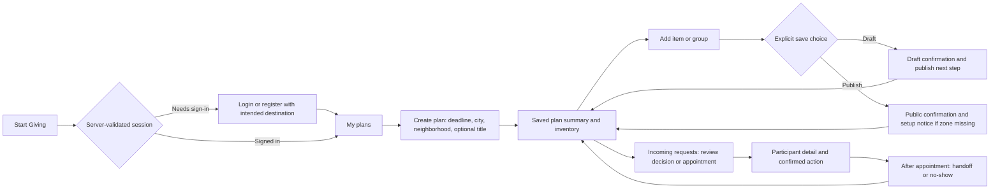
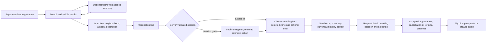

# Milestone 6.1 — UI/UX design audit and refinement proposal

Status: **design review only; no UI implementation is approved or included**.
This develops the [initial plan](milestone-6.1-ui-ux-plan.md) against the existing
product. Engineering Hardening remains complete; its
[deferred public-launch gates](production-readiness.md#deferred-public-launch-readiness-items)
are separate and unchanged.

The two journeys work end to end on the isolated local stack. The highest-value
refinement is to make **the next useful action and the true item/request state
easier to find**, especially on mobile. Keep the shared account, private plans,
anonymous browsing, current URLs and existing lifecycle rules. A rebuild or new
frontend framework is unnecessary.

## Evidence and method

- Baseline: latest merged `main`, `e6e93af30d3ef2e6c26f1a88a7de7bacebada97a`
  (PR #28). Review date: 2026-10-25, America/Los_Angeles.
- Read React routes, components, CSS, validation/response handling, the README,
  initial 6.1 plan and relevant pickup/date/product documentation. Inspected the
  existing serializers only to identify limits of frontend-only proposals.
- Built the unchanged CRA production bundle and used existing `e2e/local.cjs`
  and its verified disposable MongoDB replica-set helper. No development,
  staging or production database was connected. Only synthetic local fixtures
  were created; the original 16 demo records were copied unchanged into that
  disposable database for legacy-page review. Owned test resources were removed.
- Chromium review: desktop **1440×1000**, tablet **768×1024**, touch-emulated
  mobile **390×844**; additional discovery reflow check at **320×800**. Browser
  locale `en-US`, timezone `America/Los_Angeles`. There were 62 page/state
  observations, including repeated routes at different widths. Captured 64 local
  screenshots; [16 unaltered representative captures](assets/milestone-6.1/README.md)
  are included. These are current UI evidence, **not proposed mockups**.
- Synthetic scenarios include multiple/empty plans, draft/published/unlisted/
  cleared/future-availability items, all six pickup states and three accounts.
  The fixture's existing test clock produced completed/no-show records without
  waiting for a real appointment. Loading, 503 and expired-session views used
  browser-only response interception. No real session/configuration was changed.
- Walked through plan creation/draft addition, request submission, login with a
  register/login detour, status views, failed-search retry and an unsaved-edit
  departure. Also checked skip-link focus, measured layout/control sizes, and
  ran axe on authenticated inventory/account pages at all three main widths.
- Used Nielsen-style task efficiency, recognition, consistency, status visibility,
  user control and error prevention/recovery heuristics; checked relevant WCAG
  contrast/focus/form concerns. This is an expert audit, **not user research or
  a claim of full WCAG compliance**. No screen reader, real iOS/Safari device,
  real virtual keyboard or live hosted environment was verified.

Evidence labels below: **B** = observed in the local browser, **S** = confirmed
from source, **P** = proposed preference requiring design review. Task impact is
an assessment, not a measured user conversion/abandonment rate.

## What to retain

- Home makes Give Away / Find Free Items explicit, states that everything is free
  and allows browsing before registration. One account can do both jobs.
- Plans can exist without items; city/neighborhood are sufficient. Privacy copy
  avoids residential addresses and explains public versus private content.
- The short item-name-first form and optional-details disclosure support repeated
  addition. Successful draft creation resets/focuses the next name field.
- Discovery URL filters, server pagination, readable date windows and back links
  already exist. Login/register switching returned to the intended request form.
- Pending versus accepted versus handed-over wording prevents an acceptance from
  being mistaken for collection. Action confirmations and server checks matter.
- Loading/status text, retry controls, expired-session messages, explicit labels,
  keyboard skip link and mobile menu Escape/focus return are useful foundations.
  No horizontal document overflow was measured in the reviewed scenarios.

## Page-by-page review

Paths containing `:id` represent the existing dynamic routes. Findings refer to
the prioritized matrix below; screenshots are linked in the evidence index.

Source entry points: [routing/shell](../giftlink-frontend/src/App.js),
[plan forms](../giftlink-frontend/src/components/MoveOutPlans/PlanForm.js),
[inventory](../giftlink-frontend/src/components/Inventory/Inventory.js),
[discovery/details](../giftlink-frontend/src/components/Inventory/PublicItems.js),
[pickup flows](../giftlink-frontend/src/components/Pickups/Pickups.js) and
[account styles](../giftlink-frontend/src/components/Profile/Profile.css).

| Page / actual component | Observed strengths and friction | Finding IDs |
| --- | --- | --- |
| `/`, `Home` / `Journeys.css` | Clear two-path identity and free/private reassurance. Mobile stacks the giver first; the receiver CTA is lower but remains visible within the captured 844px viewport. Tightening copy/spacing is a preference, not a broken funnel. | C5 |
| Global `Navbar`, `JourneyNav`, `App` routes/footer | Mobile/tablet menu and secondary journey links work. A directly opened giver pickup detail has correct Give Away subnavigation but no active primary journey. Unknown `/app/does-not-exist` renders shell/footer with no main explanation. | B1, A7 |
| `/app/plans`, `MyPlans` | Multiple plans and helpful first-plan empty state. Card title opens a detail page; actual inventory action is a smaller text link. Card has status/deadline but no clearance counts in this response. Do not invent counts. | B2, D3 |
| `/app/plans/new`, `PlanForm` | Four minimal core fields; no address. Extra timezone field exposes IANA syntax and a substantial warning. It can be omitted, then published items cannot receive requests. Empty submit marks three fields but leaves focus on Create plan. | A2, A4, C4 |
| `/app/plans/:id`, `PlanDetail` | Privacy, deadline and Manage items are explicit. Creation lands here before another click to inventory. No automatic progress summary on this page. Existing URL should remain even if post-create destination changes. | B2 |
| `/app/plans/:id/edit`, `PlanForm` | Existing status/timezone values and cross-item date conflict handling are present. Consequences of changing location/timezone compete with everyday form content; errors are not uniformly connected to controls. Native confirmation handling was source-reviewed, not conflict-race tested. | A4, C4 |
| `/app/plans/:id/items`, `Inventory` / `ItemForm` | Cleared/total, filter, optional fields and repeated add work. On mobile the first item starts about **1204px** down, below the add form. Reserved desk still reads Available; lifecycle and publication meanings compete. | A1, A3, A8, B3 |
| Item editor and item action rows | Edit scroll/focuses the name field; public-save and removal confirmations exist. Same-looking Edit, Unlist and Mark cleared buttons have different consequences. Unsaved new-item text was lost after Back to plan → Manage items. | A3, A8, C1 |
| `/app/pickups/incoming`, `PickupDashboard` | All six states, participant name, plan link and appointment zone are visible. Completed/declined cards can precede pending work; status filters help, but each card still requires opening to decide. No need to add bulk accept actions. | B4, A10 |
| `/app/pickups/:id` as giver, `PickupDetail` | Participant-only data, note, appointment, confirmation and history are clear. Reload precedes primary content; actions follow long explanatory text. Early handoff/no-show buttons are disabled and require a reload to reconsider time eligibility. | A9, B1, C1 |
| `/app/items`, `Discovery` | Anonymous search, location/availability/sort and explicit Apply/Clear work; six public cards appeared. At 390px the first result starts around **1124px**, after all filters and repeated instructions. | B5, C4 |
| `/app/items/:id`, `PublicItemDetail` | Free/location/window/description, sharing and request CTA are available. A reserved item still has Available Now and Request pickup; missing-timezone listing has no CTA. General date availability is not reservation availability. | A1, A2 |
| `/app/items/:id/request`, `RequestPickup` | Auth return and real submission worked. Many paragraphs precede/complement one time input. Note textarea is about 195px wide on a 358px content area. Another receiver was refused only after filling the reserved-item form. | A1, C3, C4, D2 |
| `/app/pickups`, `PickupDashboard` | Tracks pending, accepted, declined, cancelled, handed-over and no-show requests. Cards use large repeated date/zone blocks; useful pending/accepted work may require scrolling. Filtered-empty text does not distinguish no matches from no history (S). | A10, A12, B4 |
| `/app/pickups/:id` as receiver | Same role-safe detail, note and history. Terminal states have little explanation of what happens next; Receiver did not arrive is giver-reported but reads as an unqualified accusation. No messaging or giver reply is available. | A10, D2 |
| `/app/login`, `LoginPage` | Labels/autocomplete, generic auth error, busy state and intended return are present. At tablet width the Email control is only **183px** wide; verbose account copy wraps heavily. | C2, A4 |
| `/app/register`, `RegisterPage` | Shared-account message and password requirement are present. Native validation and a joined server-error paragraph differ from plan errors; internal field names can appear. Password is cleared on failure; no password-reset feature should be implied. | A4, C2, D5 |
| `/app/profile`, `Profile` / `Profile.css` | Email is read-only, editable names and save feedback exist. Name controls are around **30px** high; type-attribute CSS selectors miss these default-text inputs. Save text contrast is **3.23:1**. | A5, C3 |
| Demo `/app`, `/app/search`, `/app/product/:id` | Original 16 records and image-based browsing remain. Demo search has weak heading/landmark/search-label semantics (S). Detail says Comments / Just DMed you without identifying those comments as examples, conflicting with the actual no-messaging product. | A11 |

### State and recovery review

| State | Evidence / treatment |
| --- | --- |
| Loading | Listings and session checks show real status text; local delayed-response capture confirms the result state. Keep this; skeletons are optional. Reserve layout space before adding animation. |
| Empty | No-plan state explains what to do; no-match discovery suggests changing/clearing filters. Request-filter emptiness needs context (A12). Avoid onboarding illustrations that add mandatory steps. |
| Validation | Empty plan submission produced three linked core-field errors, but focus stayed on the submit button. Timezone errors lack the same `aria-describedby` / `aria-invalid` linkage; item/register/API errors often concatenate field names (A4). |
| Success | Local UI plan creation and Save draft & add another succeeded; next name cleared. Success must identify draft versus published, with a visible route to publication (A8). |
| Busy / disabled | Fieldsets/submit controls disable during writes. Future appointment completion/no-show are disabled with explanatory text. Do not turn on an action by presentation alone or bypass backend time/version checks. |
| Service error | Intercepted 503 displayed Retry results; removing the fault and retrying restored actual local results. Existing offline tests cover HTML fallback and session recovery. Keep these paths. |
| Expired session | Intercepted `/api/me` 401 displayed the login/session-ended message. Preserve intended destinations and existing privacy protection. |
| Conflict / uncertain write | Stale-version errors, destructive-change confirmations and 15-second timeout recovery were source-reviewed. Do not silently resubmit; next-step copy should explain reload/review. New conflict-race, timeout and destructive-action browser scenarios were not executed in this audit. |

## Prioritized improvement matrix

Severity: **Critical** = blocks a core journey without a practical recovery;
**High** = substantial avoidable effort, state ambiguity or access barrier;
**Medium** = recoverable friction; **Low** = polish. No Critical defect was
reproduced. Priority **P1** = first refinement batch, **P2** = next focused batch,
**P3** = optional polish/deferred product decision. Complexity **S/M/L** describes
scope/coupling, not days: local styling/copy; several component/state changes;
cross-cutting navigation or a separately scoped product/API change.

### A. Usability defects

| ID / priority / severity | Affected page; observed problem and user impact | Recommended improvement | Complexity | Behavior impact |
| --- | --- | --- | --- | --- |
| A1 · P1 · High | Inventory/public detail/request form (B/S): accepted desk still Available / Available Now with Request pickup. Third account fills a form before rejection; giver cannot infer reservation from inventory. | Explain that published/date-available does not mean unreserved; preserve existing rejection and link to requests. A definitive reserved badge/early gate needs authoritative data: see D1, not a frontend guess. | S for honest copy; L for D1 | Copy only in scope; no reservation/API change approved. |
| A2 · P1 · High | Plan creation/inventory (B/S): publishing without timezone succeeds but public item cannot receive requests. Owners can believe the job is done. | Show setup-needed notice/Edit plan link and a friendly explicit chooser. Use the existing private plan endpoint: inventory's plan projection omits timezone, which must not be mistaken for an unset value. Keep plans without a zone; no silent inference. | M | Frontend guidance/fetch; changing publication requirements is out of scope. |
| A3 · P1 · High | Item/plan forms (B for item, S for other forms): leaving a dirty new-item form lost the text. Moving users face avoidable re-entry. | Define a consistent dirty-form exit warning; retain input after save errors and focus after edits. No localStorage autosave of private text without a separate privacy decision. | M–L | Changes navigation confirmations; owner approval needed. |
| A4 · P1 · High | Plan/item/register/request forms (B/S): errors differ, some expose technical field names, first invalid input is not focused; timezone linkage is incomplete. | Shared field/error pattern, human labels, focusable summary and first-invalid focus; keep server validation and exact constraints authoritative. | M | Focus/error presentation changes; same validation and API behavior. |
| A5 · P1 · High | Account Save (B) has 3.23:1 white-on-`#2190ff` text. Global plan/task primary hover/focus (S, visible in validation capture) uses white-on-`#009688`, calculated 3.67:1. Both miss 4.5:1 for normal text. | Use an accessible primary-button treatment in all interactive states; verify default/hover/focus/disabled combinations. | S | Styling only. |
| A6 · P1 · Medium | Inventory Back to plan and other default links (B/S): axe finds low contrast on light grey; footer fix did not cover all task links. | Scope an accessible body-link color and test affected surfaces; avoid a global override that breaks dark buttons. | S | Styling only. |
| A7 · P2 · Medium | Unknown client routes (B/S): shell/footer without a page explanation or task recovery. | Add a concise not-found view with home/browse return paths; preserve all existing valid URLs. | S | New fallback presentation for invalid URLs only. |
| A8 · P1 · Medium | Add form (B): Save draft is visually primary, Publish secondary; “add another” returns focus above the list, so publication is easy to overlook. | Keep distinct explicit actions and a clear Saved as draft / Published confirmation with Review item or Publish next step. Default-action changes need approval. | M | Confirmation/navigation changes; no implicit publication. |
| A9 · P2 · Medium | Accepted pickup detail (B/S): early actions are disabled; they do not reconsider elapsed time until a render/reload. | Explain when each action becomes eligible near the buttons; consider a lightweight timer refresh of existing time state, retaining fresh backend checks. | S–M | UI eligibility refresh only; no time-policy change. |
| A10 · P2 · Medium | Request tracking/detail (B/S): terminal states and raw cancellation labels give little next-step guidance; no-show wording lacks reporting context. | Use neutral “Marked as no-show” with giver-report context, outcome explanation and browse/requests link. Keep pending ≠ reserved and accepted ≠ handed over. | M | Copy/links only; no reopening, resubmission or reassignment. |
| A11 · P2 · Medium | Legacy demo detail/search (B/S): canned DM comments look real; search headings/labels/landmarks are weak. | Explicitly identify sample comments and demo data; provide semantic heading/labels/back link. Preserve fixture records/images/IDs and live demo URLs. | S–M | Demo presentation only; no messaging feature or data rewrite. |
| A12 · P2 · Medium | Filtered pickup dashboards (S): “No pickup requests here yet” can mean a filter with no matches. | Distinguish no history from no results for this filter, offering Clear status filter. | S | Empty-state presentation only. |

### B. Information architecture improvements

| ID / priority / severity | Affected page; observed problem and user impact | Recommended improvement | Complexity | Behavior impact |
| --- | --- | --- | --- | --- |
| B1 · P2 · Medium | Direct pickup-detail navigation (B/S): secondary journey is correct but primary navigation has no active section without navigation state. | Derive active journey from the existing resolved participant role; add a compact contextual item/plan heading. Verify pasted URLs/reload and both roles. | M | Navigation highlight/context only; never infer authorization from UI state. |
| B2 · P2 · Medium | My plans/create/detail (B/S): user can take Create → detail → Manage items before adding; inventory CTA competes with title link. | Make Manage items the clear card task; propose create → inventory with a saved-plan summary, retaining detail/edit URLs and empty-plan support. | M | Post-create destination changes only if owner approves. |
| B3 · P1 · High | Mobile inventory (B): first item at ~1204px; existing users scroll past the add workflow to manage pickups/items. | Show plan/progress and inventory first when populated, with an explicit Add item expansion and an optional keep-adding mode. Empty inventory can keep the form open. | M | Disclosure/focus changes; retain fast repeated entry and all actions. |
| B4 · P2 · Medium | Incoming/sent dashboards (B): newest terminal cards can hide pending decisions/accepted appointments; actions require detail navigation. | Offer clear task-oriented links to existing status filters and a concise card action “Review request”; retain All, pagination and safe confirmation detail. | M | Filter/navigation presentation; no guessed counts, global resort or bulk accept. |
| B5 · P1 · High | Mobile discovery (B): first result at ~1124px in an 844px viewport; all facets and instructions precede browsing. | Keep search, result context and Filters near the top; disclose city/neighborhood/availability/sort in an accessible region with applied-filter summary and Apply/Clear. | M | Filter disclosure/focus changes; preserve URL values, submit semantics, Back and pagination. |

### C. Visual design improvements

| ID / priority / severity | Affected page; observed problem and user impact | Recommended improvement | Complexity | Behavior impact |
| --- | --- | --- | --- | --- |
| C1 · P2 · Medium | Inventory/request action rows and status badges (B): unrelated consequences share equal outline/grey treatment. Recognition depends on rereading. | Define one primary, secondary and destructive treatment; pair status text with restrained semantic accents. Do not use color alone or conflate item and request lifecycles. | M | Styling/hierarchy only; confirmations remain. |
| C2 · P1 · Medium | Login/register at tablet (B/S): global 15% container padding plus Bootstrap columns compresses Email to 183px at 768px, versus 230px on desktop. | Scoped account-form shell with a readable max width and small-screen gutters; remove accidental legacy-layout coupling without changing other `.container` pages blindly. | S–M | Layout only. |
| C3 · P1 · Medium | Profile and coordination note (B/S): 30px name inputs/default textarea versus 47px plan controls; inconsistent width and spacing weaken touch use. | Reuse field/textarea classes, full content width and ~44px touch targets. This target is a usability proposal, not a claim all smaller controls violate WCAG. | S | Styling only. |
| C4 · P2 · Medium | Plan/inventory/pickup copy (B): raw dates, localized dates, IANA names and lengthy UTC/DST rules compete with actions. | Consistent readable date/zone labels, compact essential timing and expandable detailed help. Keep critical limits visible when choosing a time; never alter UTC cutoff/DST rejection semantics. | M | Presentation only; no timezone inference or date-policy migration. |
| C5 · P3 · Low | Home/typography/surface spacing (P): current identity is coherent enough; different page widths/spacing could be calmer and more consistent. | Refine a small spacing/type scale and common page header; retain the existing name, two-path home and green/blue identity until reviewed. | S–M | Visual preference only; no rebrand approved. |

### D. Optional product enhancements — outside refinement implementation

| ID / priority / severity | Gap and why it matters | Recommendation for a separate decision | Complexity | Behavior impact |
| --- | --- | --- | --- | --- |
| D1 · P3 · High | A1 is real, but current public/owner item DTOs do not expose authoritative reservation state. A badge inferred from one page of requests can lie. | Separately evaluate an allowed reservation indicator and its consistency/privacy contract. Within 6.1 use truthful availability wording and existing server rejection only. | L | Would affect API/data presentation; not authorized here. |
| D2 · P3 · High | Acceptance does not establish an agreed meeting place; receiver-only creation note has no giver reply channel. This is a coordination confidence gap, not solved by prettier buttons. | Owner decides a safe rendezvous/contact workflow in a later product scope. Clarify current capabilities; no addresses, fake messages or new location fields in 6.1. | L | New product/API behavior; deferred. |
| D3 · P3 · Medium | Plan-card clearance totals, pending badges and reminders are not all supplied by current endpoints. | Validate demand before adding aggregates/notifications. Present only known data, not zero/default/partial-page totals. | L | New data/notification behavior; deferred. |
| D4 · P3 · Low | Real listing photography could aid evaluation, but user uploads do not exist. | Consider separately after product/privacy work; current refinement remains text-first without fabricated photos/placeholders suggesting upload support. | L | New upload/storage/moderation scope; deferred. |
| D5 · P3 · Medium | Account recovery/password change is absent. Confused users have no in-product recovery path. | Separate identity/support decision; do not add a dead “Forgot password” link or change authentication in this design review. | L | Authentication/backend changes; deferred. |

P1 first: A2–A6, A8, B3, B5, C2–C3, plus the honest-copy portion of A1.
D1/D2 remain consequential product gaps even though optional relative to this
refinement scope; “deferred” does not mean they are solved or safe to ignore.

## Proposed revised flows

These are design proposals, not new routes or approved behavior changes.

### Give Away

Compared with today: propose removing the post-create detour, prioritizing existing
inventory, making draft/public state unmistakable and keeping fast-add optional.
Plan details remain reachable. Clearance stays the actual **cleared / total**
count, not accepted appointments. No notification, quantity splitting, bulk
action or auto-completion is introduced. Do not require timezone just to create
the plan; disclose its existing pickup-request prerequisite at the useful moment.

### Find Free Items

Retain filter state/back links and generic shared listing URLs. Keep the date
window distinct from reservation state; without D1 no design should promise that
requesting will succeed. Accepted means reserved for that appointment, not handed
over. Cancel/no-show do not automatically transfer a reservation or retry a
request. Private plan/location/participant data must not enter public cards.

## Mobile-first visual and interaction direction

This is a **recommended hypothesis for owner review**, not an approved style.
Keep Move-Out Marketplace, its current home copy/two paths and recognizable
green/blue palette. Use the existing green for brand/journey context and one
accessible blue for task actions; distinguish destructive actions through text
and a deliberate secondary treatment. Test every foreground/background and focus
combination. Prefer readable text-first cards over an image-heavy redesign.

- Start with 320–390px: normal page gutters around 16px, readable 16px body text,
  flexible controls and an approximately 44px touch target. Use a modest shared
  spacing scale and restrained heading sizes; exact values remain proposals.
- Put purpose, current state and next action before detailed guidance. Discovery
  should expose results early; inventory should expose existing items early.
  Use disclosure for secondary filters/details, with visible applied state and
  keyboard focus return. Avoid modal bottom sheets until simpler disclosure is
  shown insufficient. Keep repeat-add fast when explicitly chosen.
- Tablet should add useful width rather than shrink account forms. Desktop may
  show two/three result columns and bounded reading/form widths; do not stretch
  every form across the screen or replace the existing navigation architecture.
- Use status **text plus** icon/accent if helpful: draft/private, published/date
  window, cleared and expired are item concepts; pending/accepted/terminal
  outcomes are request concepts. Never substitute a guessed reservation badge.
- Put appointment, zone and consequence near the relevant action. Detailed UTC,
  DST and public/private guidance remains accessible; reduce repetitive prose
  without hiding booking restrictions or implying an exact address is shared.
- Preserve visible keyboard focus, landmarks, labels and live feedback. Make
  validation focus deliberate and recovery specific. Respect reduced motion;
  animations and skeletons are optional, not a new design-system requirement.

## Reusable UI patterns worth consolidating

| Pattern | Current sources | Smallest useful consolidation |
| --- | --- | --- |
| Page header / journey context | `App`, `Navbar`, `JourneyNav`, plans/discovery/pickup wrappers | Shared spacing, heading and task-action conventions; resolved-role active navigation. |
| Form field / help / validation summary | `PlanForm`, `ItemForm`, login/register/profile/request forms | One label/help/error association and control class; focus behavior, textarea width and busy semantics. Keep per-form rules. |
| Async state | `usePlansData`, multiple `LoadState`s, `AccountServiceNotice`, discovery | Consistent loading/empty/retry/success wording and layout while retaining page-specific recovery/auth behavior. |
| Item / request status | Inventory labels, `PickupWindow`, `pickupLabels`, `plan-status` | Separate semantic label maps sharing presentation; never collapse different lifecycles into one generic status. |
| Actions and confirmations | Inventory rows, plan actions, native confirmations, pickup decisions | One primary/secondary/destructive visual convention; explicit consequences and keyboard-safe focus. Preserve all confirmations. |
| Date / appointment presentation | `formatDeadline`, raw inventory strings, `Appointment`, timezone input | Reuse date-only versus instant formatters appropriately; friendly zone label plus authoritative IANA value. No conversion-policy change. |
| Cards / lists / filters | `plan-panel`, `plans-grid`, discovery and request cards | Reuse surface/spacing styles; retain distinct information order and existing pagination. |

Start with existing React components and CSS/custom properties. No UI library,
token pipeline, router migration or generalized form framework is needed. Scope
legacy `.container`, `.row` and `.btn-primary` interactions carefully; keeping demo
routes stable is part of acceptance, not grounds for a wholesale stylesheet rewrite.

## Phased implementation proposal — small reviewable PRs

No PR below is started or authorized by this audit. Each follows design approval,
has its own focused diff and preserves existing URLs/API contracts/fixtures.

| Order / proposed PR | Focus and IDs | Evidence required before acceptance |
| --- | --- | --- |
| 1. Fields and access fixes | A4–A6, C2–C3: accessible account/form layout, contrast, labels, errors; no validation-rule changes | Desktop/tablet/mobile before/after captures, keyboard invalid-submit focus and targeted axe; auth/intended-return tests still pass. |
| 2. Discovery hierarchy | B5, honest A1 copy: compact search/results and accessible filter disclosure | URL/Back/Clear/Apply/page continuation preserved; mobile results visible early; existing discovery tests plus filter-focus checks. |
| 3. Giver task hierarchy | A2, A8, B2–B3: setup notice, plan/inventory CTA, populated-versus-empty layout, optional fast-add | Create empty plan and repeatedly add draft/publish; no accidental publication; all progress/actions/legacy links unchanged. Decide post-create destination first. |
| 4. Dirty-form navigation | A3 only, as a separately bounded change | Warn before discarding meaningful edits; cancel stays on draft, confirm navigates, successful save does not warn; no private browser-persistent autosave. |
| 5. Pickup clarity | A9–A10, A12, B1, B4: role context, request cards, neutral outcomes, time eligibility and precise empty states | Both participant roles, direct links, six states and disabled-action explanations; current backend checks and confirmations preserved. No D1/D2 additions. |
| 6. Visual / copy consolidation | C1, C4–C5, A7, A11: shared action/status/date presentation, scoped CSS, invalid-route/demo clarity | Reviewed style sample and cross-route captures; demo records/images/URLs intact; existing tests/build remain green. |

Do not enlarge one PR to implement a new design system or solve infrastructure.
Run the relevant existing frontend tests/build and local browser checks per
future change; retain normal CI. Broader regression suites run as existing CI
requires. Any hosted verification/deployment needs separate authorization.

## Owner decisions before UI implementation

1. **Direction:** approve or revise the retained green-brand/blue-action,
   text-first refinement and proposed typography/spacing sample. No rebrand or
   image-heavy design is assumed approved.
2. **Task hierarchy:** approve populated-inventory-first with an optional fast-add
   mode and the proposed Create plan → inventory destination. Keep all existing
   detail URLs. Decide whether Save draft remains the default; recommendation is
   to keep explicit separate actions and avoid changing publication defaults.
3. **Navigation/control behavior:** approve dirty-form exit warnings and compact
   mobile filter disclosure. Decide what must remain visible, with no new forced
   onboarding or account roles.
4. **Availability truthfulness:** approve the limited copy/setup-notice fix now;
   explicitly defer D1 or authorize a separate authoritative-data design later.
   Do not approve definitive reserved badges based on incomplete client data.
5. **Time and outcomes:** approve friendlier zone/error/neutral no-show wording
   while preserving current date cutoffs, DST rejection and state transitions.
6. **Demo boundaries:** approve explicit sample-comment labels/semantic cleanup
   while retaining all 16 gifts and their routes. Do not imply real messaging.
7. **Product gaps:** decide whether rendezvous, account recovery, notifications,
   aggregates and photography deserve separate future scopes. None is included
   in these refinement PRs; public-launch approval remains separate.

## Verification and limits of this review

- Unchanged frontend production build: **passed** (`CI=true`, same-origin API).
- Existing isolated `readiness.spec.cjs` and `offline.spec.cjs`: **4/4 passed**
  across desktop/mobile. Anonymous home/discovery/login/register scans pass;
  authenticated inventory/account scans found A5/A6. The difference is coverage,
  not a claim that the earlier anonymous checks certified the whole app.
- Local capture walkthrough: **completed**, 62 page/state observations and 16
  diagnostic checks (including six authenticated axe scans reporting findings,
  keyboard, validation, navigation loss, auth return, request submission/retry
  and preservation of 16 demo gifts). These are audit observations, **not 62
  passing tests or a clean accessibility result**.
- Source-only limits remain for conflict races, every disabled/inactive-plan
  variant and exact production protection; none was represented as newly tested.
  Backend runtime/security code, APIs, auth, MongoDB administration, hosting and
  GitHub Actions were not modified. No new dependency, remote E2E or manual
  deployment was used. Normal PR CI is retained without workflow changes.
