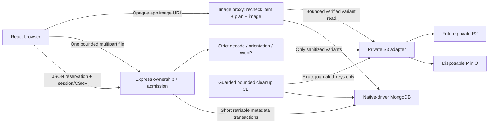

# Milestone 6.5A — Photo architecture proposal

## Status and decisions

**Design only.** Baseline: remote main
`f9ac7cd4a13f889a5ab3e75b9e625e160f6d8300`, including merged #58 and 6.4A–6.4E.
The working tree was clean before creating `codex/m65a-photo-architecture`.
No upload code, package, index, bucket, lifecycle rule, credential, provider
configuration, database migration or deployment is added by this PR.

Owner-approved requirements remain fixed: **private Cloudflare R2** in eventual
production; **disposable Docker MinIO** locally; **five photos maximum** per item;
photos **optional** for publication; **400px thumbnail and 1280px display WebP**;
first photo is cover, with owner reordering; owner deletion with physical cleanup;
account quotas in the first implementation. AI/video are excluded. Thirty days
after verified handoff is a **retention proposal, not deletion authorization**.
R2 activation still requires separate approval.

Recommend **one bounded multipart image per request through Express**, after a
small JSON reservation, with Sharp processing before storage. Read through a
**same-origin, authorization-checking image proxy**, never a public bucket or a
browser-visible storage URL. MongoDB stores metadata/operation records, not image
bytes. No worker, queue service, CDN, new frontend framework or second messaging
system is needed initially. This is conditional on the packaging/resource gates
below; it is not a claim that a hosted Sharp workload has already been tested.

Companion documents: [security, permissions and lifecycle](milestone-6.5-security-and-lifecycle.md)
and [implementation PRs, tests and approval gates](milestone-6.5-implementation-roadmap.md).

## Actual repository integration points

These links are existing files at the audited baseline. Names labelled **new**
below are proposed files, not current commands or implemented APIs.

| Existing location / behavior | Future integration and constraint |
| --- | --- |
| [`app-factory.js`](../giftlink-backend/app-factory.js), `createApp` | Inject an image service/storage adapter; mount owner image routes and image reads before the API 404 handler. Keep global JSON limit **32kb**, cookie parsing, diagnostics and no-store behavior |
| [`middleware/identity.js`](../giftlink-backend/middleware/identity.js), `protectWrites`, `requireAuth`, `optionalAuth` | Writes currently demand exact `APP_ORIGIN`, `X-CSRF-Protection: 1` **and application/json**. Add a narrowly registered PUT-content multipart exception while retaining both security checks; every other API write stays JSON-only. Authenticate/verify ownership before parsing bytes |
| [`index.js`](../giftlink-backend/index.js), `createHostedApp` | Warm initialization/pool, target verification and backoff already exist. Retain `X-Deployment-Target` fencing before media requests. Lazy-load native processing on upload, not every text request. Do not change current health DTO or initialize storage remotely on import |
| [`runtime.js`](../giftlink-backend/runtime.js), [`server.js`](../giftlink-backend/server.js), [`config.js`](../giftlink-backend/config.js) | DB/index/topology checks precede listening. Proposed media config is validated separately; default disabled means no storage client/network call. No startup DDL, bucket creation or demo import |
| [`routes/itemRoutes.js`](../giftlink-backend/routes/itemRoutes.js) | Current mergeParams owner router uses session-derived owner + validated plan/item IDs, strict fields/versioned PATCH and POST actions. Extend under the same canonical plan/item hierarchy, using separate photo routes rather than item JSON/base64 |
| [`services/inventory.js`](../giftlink-backend/services/inventory.js), `planTransaction`, `createInventoryService`, `itemResponse` | All plan/item writes touch `moveOutPlans.inventoryRevision` inside snapshot/majority transactions. Photo metadata mutations must use the same boundary. No storage or Sharp I/O inside a retriable transaction callback |
| [`services/plans.js`](../giftlink-backend/services/plans.js), [`services/pickup-policy.js`](../giftlink-backend/services/pickup-policy.js) | Location/timezone/window/withdrawal changes can invalidate requests after confirmation. Photo edits must not cancel requests or change these rules. Reads derive current visibility; no copied public/private flag on an image |
| [`services/pickups.js`](../giftlink-backend/services/pickups.js) | Existing accept/complete/cancel/no-show, versions and `clearedByPickupRequestId` distinguish reservation from handoff. Do not label acceptance/manual clearance as a retention trigger or add photo snapshots to requests |
| [`services/discovery.js`](../giftlink-backend/services/discovery.js), `eligibilityStages`, `browse`, `detail`, `publicItem` | Feed excludes reservations; direct detail still returns an eligible reserved listing. Keep regional matching/exact facet totals/cursors. Enrich only the selected page with a batched cover lookup **after** item count/pagination, not an image unwind before counting |
| [`services/pickup-communication.js`](../giftlink-backend/services/pickup-communication.js), `reserveMessage`, `authorize` | Account message counters use MongoDB `$$NOW` in the send transaction. Photos require separate reservations, byte accounting and compensation; do not copy counters as if S3 joins the transaction. Closed text-history permission is not photo permission |
| [`services/identity.js`](../giftlink-backend/services/identity.js), `privateUser`, [`routes/meRoutes.js`](../giftlink-backend/routes/meRoutes.js) | Current user/profile DTO is explicitly allowlisted. Keep proposed account media counters private, preserve them during profile `$set` updates and test all auth/profile serializers; do not return the raw authenticated user document |
| [`services/database-indexes.js`](../giftlink-backend/services/database-indexes.js), [`util/prepare-database.js`](../giftlink-backend/util/prepare-database.js), [`util/database-target.js`](../giftlink-backend/util/database-target.js) | Registry, dry-run/conflicts and exact DB/environment/fingerprint apply guard are authoritative. Add proposed definitions only in 6.5B; startup remains read-only and fails without required indexes |
| [`Inventory.js`](../giftlink-frontend/src/components/Inventory/Inventory.js), [`ItemForm.js`](../giftlink-frontend/src/components/Inventory/ItemForm.js) | A name-only draft creates the item first; manage photos separately against its real ID. Preserve item drafts, repeated add, publish validation and inventory status/progress |
| [`PublicItemCard.js`](../giftlink-frontend/src/components/Inventory/PublicItemCard.js), [`PublicItems.js`](../giftlink-frontend/src/components/Inventory/PublicItems.js) | Add optional cover/gallery; no-photo and legacy records stay text-first. Preserve region/filter/session scopes and owner-aware actions |
| [`Pickups.js`](../giftlink-frontend/src/components/Pickups/Pickups.js) | Optional current-item thumbnail only when photo policy permits. Do not modify `PickupConversation`/`PickupScheduling` or store attachments in messages |
| [`api/client.js`](../giftlink-frontend/src/api/client.js) | Existing helper JSON-stringifies writes and aborts after 15 seconds. Use a separate bounded FormData upload helper; do not send binary through this JSON helper or relax its existing contract |
| [`UnsavedChanges.js`](../giftlink-frontend/src/forms/UnsavedChanges.js), [`primitives.js`](../giftlink-frontend/src/design-system/primitives.js) | Independent photo/file draft guard; Surface/Feedback/native buttons and focus. No localStorage private drafts or new UI framework |
| [`isolated-mongo.js`](../giftlink-backend/test/helpers/isolated-mongo.js), [`e2e/local.cjs`](../e2e/local.cjs) | Owned Docker/process/loopback/empty DB checks and production-mode local HTTPS already work. Add a separate verified MinIO fixture; never infer that local MongoDB implies local storage |
| [`e2e/policy.cjs`](../e2e/policy.cjs), [`e2e/cleanup.cjs`](../e2e/cleanup.cjs), [`deployment/frontend-config.cjs`](../deployment/frontend-config.cjs) | Current hosted budgets/cleanup do not include image objects or photo quotas. Keep them unchanged. Preserve host-scoped `/api` proxy and production isolation; normal local media tests must not become hosted fixtures |

The 16 `gifts` demo records and their existing `image` string field/legacy routes
are separate from canonical `items`. Do not reinterpret their numeric IDs as
item IDs, import their image URLs, download external originals, migrate them or
make photos a publication requirement. Existing items with no media fields read
as no photos; no backfill is required.

## Request and trust boundaries

S3 never participates in MongoDB commit/rollback. Durable image rows are the
operation ledger; their generation keys are registered **before** any PUT.
Provider I/O occurs between transactions. Recheck state/lease/ownership before
publishing metadata. Failed or ambiguous work stays tracked and invisible.

## Proposed data model

`itemImages` is appropriate: independent upload/deletion state, up to five visible
images, and potentially longer-lived cleanup tombstones do not bloat every item
or its retried replacement. IDs below use native BSON ObjectId and dates use UTC
BSON Date; all fields are server-derived unless explicitly marked input.

| Field | Meaning / invariant |
| --- | --- |
| `_id`, `itemId`, `planId`, `ownerId` | Server image ID and canonical validated ownership chain; owner never comes from request data |
| `clientUploadId`, `intent` | Validated random client UUID, expected byte length and SHA-256 of selected input; bind replay intent. Server verifies actual bytes/hash. No original filename, EXIF, GPS or raw image |
| `state` | `reserved`, `processing`, `ready`, `failed`, `delete_pending`, `deleted`; only `ready` can supply a DTO image |
| `sortPosition` | Contiguous 0…n-1 among ready images only; first is cover. Pending images have null position and append at successful commit |
| `storageBinding`, `generation` | Server-configured target fingerprint/namespace plus random write-generation UUID; immutable. Never trust a caller's URL/bucket/key |
| `variants.thumbnail`, `variants.display` | Private key, exact byte count, output SHA-256, width/height, `image/webp`, and individual PUT outcome (`not_started`, `unknown`, `stored`, `rejected`, `deleted`). Both bounded variants must be verified before ready |
| `lease`, `version` | Owner-independent processing/cleanup fencing token, expiry, row revision; stale workers cannot finalize/delete current metadata |
| `charge` | Reserved byte ceiling or actual retained bytes; held-success/concurrency settlement flags and quota day. Settled atomically exactly once with quota document |
| `cleanup` | Requested reason, next attempt, retry count, bounded sanitized error category, lease/fence and verification outcome; never raw provider/Sharp error text |
| `needsMaintenance`, `maintenanceDueAt` | Indexed due work: expired upload lease or requested cleanup, not a retention expiry |
| `createdAt`, `updatedAt`, `readyAt`, `deleteRequestedAt`, `deletedAt` | Server timestamps; null until the corresponding transition |

Add optional `items.imageRevision` (missing means 0). Only photo list mutations
increment it; keep `items.version` for the existing text/availability contract.
This avoids invalidating unsaved item text every time a photo finishes. Existing
`mutate` copies the loaded item before `replaceOne`, preserving this additive
field; retain that behavior and test concurrent text/photo writes under
`planTransaction`. Never infer new authority from imageRevision alone.

Use an optional **`users.itemImageQuota`** aggregate, distinct from
`pickupMessageQuota`. The existing account document is the multi-instance
serialization point; no new quota collection or first-use upsert race is needed.
Store UTC-day attempts,
successful/held-success counts, reserved bytes, retained bytes and active upload
leases, plus a retained-operation count. This document and each image charge change
in one MongoDB transaction.
Initialize absent fields atomically on the existing authenticated user, never
upsert/recreate a missing account. The durable cross-store operation ledger stays
in itemImages; these are not rollback-safe message counters. Photo and message
transactions can contend on the account; measure it rather than adding another
collection speculatively. No quota IDs/counters enter user/profile/public
serializers and no migration/backfill is needed.

Ready order is an application transaction invariant, not a unique numeric-position
index: MongoDB does not defer unique checks during a swap. Reorder the exact
current ready-ID set in one transaction, checking imageRevision. No duplicate/
foreign/missing IDs or partial “cover only” list. Use server ordering plus `_id`
as defensive tie-breaker; malformed order fails closed for writes, never repairs
data in a GET. Deletion renumbers remaining ready photos in the same transaction.

### Proposed registry additions — no index execution here

All use binary/simple collation. Account quota updates use the existing users
unique `_id` index; there is no new quota collection/index.

| Collection / proposed name | Key and options | Query |
| --- | --- | --- |
| itemImages / `images_item_state_order` | `{itemId:1, ownerId:1, state:1, sortPosition:1, _id:1}` | Owned/current ready images and active-slot checks |
| itemImages / `images_item_upload_unique` | `{itemId:1, clientUploadId:1}`, unique | Same upload ID cannot create a second image, even after deletion |
| itemImages / `images_due_work` | `{maintenanceDueAt:1, _id:1}`, partial `{needsMaintenance:true}` | Bounded lease-expiry/deletion work, not automatic retention |
| itemImages / `images_owner_state` | `{ownerId:1, state:1, _id:1}` | Paged account storage reconciliation |

6.5B extends registry/preflight tests and count-only conflict inspection for these
new collections. Existing incompatible/duplicate/malformed experimental data must
block preparation, not be rewritten. Same guarded `db:prepare` dry-run and exact
apply confirmations; no TTL, startup DDL or silent normalization. Because the
current startup checks the registry globally, a future backend adding these
definitions requires separately approved index preparation **even if uploads are
disabled**. An additive index is not automatically authorized on Atlas.

## Proposed API contract

Let `P = /api/move-out-plans/:planId/items/:itemId/images`. Invalid/foreign parent,
item or image references use generic 404; private routes require `requireAuth`.
All controls reject extra fields and return the existing `{error:{code,message}}`
shape, optionally allowlisted field errors/retry delay. No raw error/body/filename.

| Method/path | Input | Output / semantics |
| --- | --- | --- |
| GET `P` | No write/query side effect | `{imageRevision, images, uploads, limits}`; ready images plus bounded active/recent operation statuses (max 5 active + 20 recent), no private keys/owner IDs |
| POST `P/uploads` | JSON `{imageRevision,clientUploadId,byteLength,sha256}` | 201 new reservation `{upload:{id,state,expiresAt},imageRevision,limits}`; exact duplicate intent returns existing operation (200), different intent 409; quotas/slots reserved before bytes |
| PUT `P/:imageId/content` | One `multipart/form-data` file; no extra fields; intent bound to reservation | 201 ready image and fresh imageRevision only after commit. Already ready same operation returns 200; processing/unknown returns 202 status, never a second decode/PUT. New bytes after failure require a new explicit reservation |
| GET `P/:imageId` | Owner operation lookup | State, retry/cleanup indication, safe error category and fresh imageRevision; authoritative recovery after lost responses |
| POST `P/order` | JSON `{imageRevision,imageIds:[all current ready IDs]}` | 200 canonical order/revision; 409 stale set/revision; no physical object rename |
| POST `P/:imageId/actions` | JSON `{imageRevision,action:"delete"}` | 202 logically removed/cleanup pending, or 200 already deleted; ownership rechecked on every replay. Does not imply objects already gone |
| GET/HEAD `/api/item-images/:imageId/:variant` | `thumbnail` or `display`, no arbitrary URL/key/range fetch | Authenticated-owner or current-public eligibility check, then bounded WebP response; no redirect to S3. Generic 404 inaccessible/missing image; 503 unavailable store/verification |

Use imageRevision on user list mutations; use the operation row's lease/fence on
its asynchronous completion. Two in-flight reservations need not complete in
order; each valid completion appends to the then-current ready set. A stale
completion cannot undo deletion or replace another generation. Client upload ID
is an idempotency identifier, not a bearer credential or authorization bypass.

New uploads require an existing owned item, active plan and item in draft,
available, unlisted or expired state. Photo deletion remains available to the
owner for cleared/inactive records; reorder is permitted for existing owned ready
photos. Reserved available items retain the same owner media authority as other
posted items; a photo edit never cancels appointments or claims a new handoff.
Show a publication-change confirmation on posted-item photo changes. Recheck
eligibility at finalization: a concurrent completion/plan closure hides/cleans the
new upload rather than publishing it. Existing photos are current listing media,
not immutable pickup evidence or permanent copies in a closed conversation.

### Safe DTO additions in 6.5D

Feed: optional `coverImage: null | {id,thumbnail:{url,width,height}}` only.
Public detail: optional `images: [{id,thumbnail:{url,width,height},display:{url,width,height}}]`
in ready order, maximum five. URLs are **relative application paths**, not signed
storage URLs. No owner ID, input hash, keys, bucket, credentials, filename, EXIF,
quota or cleanup information. Existing DTOs remain usable with absent fields.
Add `imageAvailability: "ready" | "none" | "unavailable"` so a failed optional
metadata/variant read never claims that an item has no photos. `none` requires a
successful eligible metadata read with zero ready images; an unavailable photo
must not turn available item results/counts into an empty marketplace.
Owner inventory adds a thumbnail and separately loaded media controls; do not
expand every inventory record with all five display variants.

Keep exact feed counts/sort/cursors independent of photos. Fetch covers in one
bounded selected-item batch, validate image owner/item/plan binding and project
DTO fields explicitly. Public reads never show reserved/processing/failed images
or use an owner endpoint to enrich an anonymous result. A request-detail thumbnail
uses current photo policy; closed text-history access grants no special media
access. A no-photo/unavailable image preserves the truthful text layout/count.

Development currently uses `urlConfig.backendUrl` (often localhost:3060) while
React runs on localhost:3000; there is no existing CRA API proxy to assume.
The proposed media URL helper accepts only the exact application image-path
shape, resolving it against the **existing configured backend URL**, or using
same-origin paths when that value is empty in hosted/local HTTPS builds. Use
credentialed image CORS (`crossOrigin="use-credentials"`) for this development
case with the existing exact `APP_ORIGIN`/credentialed CORS configuration. Do not
introduce wildcard CORS, token query parameters, arbitrary DTO URLs or a second
proxy service. Test both separate-port development and same-origin HTTPS.

## Storage adapter and configuration plan

Proposed new `services/item-image-storage.js` wraps the modular AWS S3 SDK v3;
provider configuration differs, application operations do not. No SDK is added
in 6.5A. Pin/review versions and native Sharp dependencies in the implementation.

- `putVariant`: single small PutObject, exact content length, `image/webp`, generic
  inline filename, no-store metadata, application SHA-256 metadata; fresh immutable
  generation key, conditional create where supported. **One PUT invocation per
  key**, mutation SDK retries disabled; unknown outcomes are reconciled, not replayed.
  Browser multipart is not S3 multipart upload: these small variants use PutObject,
  with no multipart-upload service/session or originals in the initial design.
- `headVariant` / `getVariant`: authenticate to the configured private target;
  bounded response length, expected size/hash/content type. ETag is not a universal
  content hash. Only a verified NoSuchKey is absence; 403, bucket-not-found,
  timeout or malformed results are unknown/failure, not deletion proof.
- `deleteVariant`: idempotent for a settled, journaled key; verify absence after
  deletion. Never run bucket deletion, ACL/public-access/lifecycle/user operations
  through the runtime adapter.
- `listNamespacePage`: operator-only reconciliation, exact namespace and bounded
  page/cursor, never an unbounded list-all/delete-all routine.
- Presigning is an S3 capability, **not the chosen public read path**. A presigned
  URL embeds its key/path and reusable bearer signature. It cannot satisfy the
  current no-storage-key-exposure contract or immediate application revalidation.
  Do not return it, 302 to it, or log it. Future direct-upload quarantine would
  need a separately reviewed, owner-only capability contract.

Keys are derived only from the configured random environment namespace + server
image ID + random immutable generation + fixed variant suffix. No username,
address, title, original filename or request/participant ID. Record intended keys
and hashes before PUT; derive/revalidate them on cleanup rather than trusting an
arbitrary stored key. Storage binding includes provider/endpoint/bucket/namespace;
changing it never silently adopts or deletes the former target's objects.

Proposed backend-only config (names are specifications, not new env settings):

| Variable | Rule |
| --- | --- |
| `ITEM_IMAGES_ENABLED` | Default false; no storage client/network side effects while disabled |
| `ITEM_IMAGE_STORAGE_DRIVER` | `minio-local` or `r2`; explicit, not inferred from credentials |
| `ITEM_IMAGE_S3_ENDPOINT`, `ITEM_IMAGE_S3_BUCKET`, `ITEM_IMAGE_S3_REGION` | Verified exact target. R2 region `auto`; local MinIO uses its configured region/path style. Never defaults to AWS or a real account |
| `ITEM_IMAGE_S3_ACCESS_KEY_ID`, `ITEM_IMAGE_S3_SECRET_ACCESS_KEY` | Backend secret store only; local credentials newly generated per run. No `REACT_APP_` secret, default MinIO password, URL credential, commit or CLI-log value |
| `ITEM_IMAGE_NAMESPACE`, `ITEM_IMAGE_STORAGE_ENVIRONMENT` | Separate development/staging/production binding; must match the expected application environment/receipt |
| `ITEM_IMAGE_MAX_*`, `ITEM_IMAGE_DAILY_*` | Validated proposed caps from the security document, within hard ceilings; no unbounded/zero-means-unlimited production option |

R2 runtime token must be restricted to the approved private bucket; separate
administration credential remains outside the app. R2 is not AWS S3 feature-
complete: its published compatibility matrix omits bucket ACL/policy/public-
access-block APIs, and checksum algorithms differ. Do not copy MinIO IAM policy
calls or SDK automatic checksum assumptions to R2. Review request-checksum SDK
defaults (including explicit WHEN_REQUIRED request/response checksum settings
where supported); use supported Content-MD5 where appropriate plus our own SHA-256, and
contract-test both configurations. No assumption of versioned-delete recovery.
No public `r2.dev` domain/custom domain, cache or lifecycle rule is enabled.

Local/CI requires **both** verified disposable MongoDB and a separately verified
MinIO container: pinned reviewed image/build digest, random run labels/credentials,
empty disposable storage, daemon/container/loopback mapping checks and a fresh
random bucket/namespace receipt. Literal loopback endpoint only, no proxy/tunnel,
arbitrary DNS, AWS credential chain, region redirect or external endpoint fallback.
Reject remote driver/endpoint even if the DB is local. Block non-loopback storage
network calls in tests. Bind any console to loopback or do not publish it. Create
the test bucket only after ownership verification; runtime never creates R2 buckets.
Reuse only a matching owned local receipt, never somebody else's volume/bucket.

**MinIO maintenance gate:** the official repository is archived and its README
says it is no longer maintained/source-only; old binaries receive no updates.
Keep the approved MinIO local architecture, but do not treat `minio/minio:latest`
as a maintained artifact. 6.5B must review a pinned build/image provenance,
vulnerabilities and AGPL obligations, and record the owner's maintenance-risk
disposition. Do not silently select AIStor, another product, a paid license or
real R2. If no acceptable disposable local artifact is available, report that
implementation blocker before provisioning; 6.5A does not run MinIO.

## Vercel viability and alternatives

| Option | Benefits | Constraints / decision |
| --- | --- | --- |
| Bounded server-mediated multipart | Existing cookies/CSRF/owner path; no raw original stored; one trusted Sharp processor; simplest compensation | Recommend initially: input ≤3 MiB, total multipart ≤3.25 MiB, one image/request; native processing admission and deadlines mandatory. Reject larger originals with friendly guidance |
| Direct PUT to private quarantine + trusted processing | Bypasses function body limit; useful for larger phone originals | Not initial scope: private unsanitized objects, expiring upload capability/CORS, hostile multipart/size enforcement, trusted read/process step, quota reservation and original cleanup all remain necessary. Direct upload is not a processing/security bypass |

The official Vercel-owned storage SDK guide explicitly documents **4.5 MB** for
server uploads. Our 3,407,872-byte multipart ceiling is below 4,500,000 bytes,
including boundaries/headers, and remains bounded even with chunked/no length
input. Five files must not be combined into one request. Browser compression may
help UX but cannot replace server limits/validation. Output display is ≤1 MiB;
proxy reads also need verified platform response/stream limits.

The official Node adapter source recognizes Express exports by `.listen` and
skips its extra request helpers for them; the current exported hosted app has
that shape. Its HTTP proxy path can nevertheless serialize/buffer the request
before Express. The separate helper path also buffers and restores the body.
Therefore admission-before-parsing applies to **our** parser/decoder, not a claim
that the hosting layer never buffers unauthenticated bytes. Keep the body margin,
test multipart through the actual supported adapter version, and include
platform buffering/concurrent requests in memory measurements. Do not add a
Next.js-specific bodyParser setting to this Express application.

Public Vercel documentation hosts were inaccessible through this environment's
network policy; an official SDK source confirms the request limit, but exact
**current account/plan memory, duration, Fluid concurrency and response limits
could not be independently verified**. Do not invent those values or assume an
old Hobby/default setting. Proposed runtime budget: one native upload pipeline
per warm instance (reject busy; no queue), Sharp concurrency 1/small bounded cache,
native processing timeouts, total server work budget 40s and client upload timeout
45s. A future explicit `maxDuration=60` is conditional on verified host support,
not a configuration change here. Existing text fetches keep their 15s timeout.

6.5B must benchmark worst permitted inputs, measure peak RSS/latency/cold start,
verify Node 22 Linux Sharp packaging and actual multipart delivery through the
Vercel adapter/proxy. Sharp's timeout excludes waiting for a libuv thread; admission
must precede body buffering/native work. Do not call Promise.race a native-memory
kill switch, claim a hard whole-request SLA or hold a Mongo transaction open over
decoding/S3. If resource targets cannot be met, reduce proposed caps in a reviewed
change or design the quarantine alternative. A separate processor/queue is only
justified after that evidence and any required infrastructure approval.

## Cost and capacity assumptions

Illustration, not measured usage or an approved spend: 100 new items/day × 3
photos = 300 images/600 sanitized objects/day. At 400 kB combined per image,
retention grows about 120 MB/day or 3.6 GB in 30 days; at the 1.25 MiB ceiling it
grows 375 MiB/day (~11 GiB in 30 days). Nothing authorizes a 30-day automatic purge;
continued storage accumulates and per-account caps do not impose a global cap.
Tombstones also consume MongoDB/index storage; the proposed 1,000-operation
account ceiling bounds that churn until a separately approved metadata-retention
policy exists. It is not an automatic garbage-collection authorization.

1,000 discovery page views/day × 20 covers + 200 detail views × 2 display images
= ~20,400 variant GETs/day (~612,000/month), excluding retries, HEAD verification,
cleanup/listing, application authorization reads and repeat no-store views.
600 PUTs/day add ~18,000 Class A writes/month; final verification/reads add Class B
operations. Proxying incurs Vercel function/transfer/DB work even when R2 egress
is free. Lazy loading and cover-only feeds matter; no scale/cost promise follows.

The pinned R2 Standard pricing source lists $0.015/GB-month, $4.50/million Class A,
$0.36/million Class B, free DeleteObject/egress, and a Standard free allowance of
10 GB-month/1M A/10M B monthly; units round up and metered connected services can
charge separately. These are source snapshots, not future billing guarantees.
Review current pricing/account eligibility, total-store limits, alerts and the
existing Vercel Hobby/Atlas operational gates before activation. No paid resource,
R2 billing setup, bucket, token or monitoring service is created here.

## Authoritative source record

Reviewed 2026-10-27 (America/Los_Angeles). Public docs sites were inaccessible;
the following **official publisher source repositories** were read at immutable
commits, not third-party descriptions. References establish API behavior, not
installed SDK/build/runtime certification.

- Vercel: [official server/client upload comparison](https://github.com/vercel/storage/blob/5425e1611f65799a02ffa0033086a56e8d280dd5/packages/blob/README.md);
  [Node Express detection/body proxy](https://github.com/vercel/vercel/blob/c628be7835e03a965b93e9cf9e2bd5ac2acbf5eb/packages/node/src/serverless-functions/serverless-handler.mts)
  and [body helper buffering/restoration](https://github.com/vercel/vercel/blob/c628be7835e03a965b93e9cf9e2bd5ac2acbf5eb/packages/node/src/serverless-functions/helpers.ts);
  live [function limits](https://vercel.com/docs/functions/limitations) and
  [duration](https://vercel.com/docs/functions/configuring-functions/duration)
  require re-verification before implementation/hosting approval.
- R2 [S3 compatibility](https://github.com/cloudflare/cloudflare-docs/blob/1ad2be0778acac23cafade2b788d6876150528e8/src/content/docs/r2/api/s3/api.mdx),
  [presigned URLs](https://github.com/cloudflare/cloudflare-docs/blob/1ad2be0778acac23cafade2b788d6876150528e8/src/content/docs/r2/api/s3/presigned-urls.mdx),
  [consistency, including negative reads/in-flight writes](https://github.com/cloudflare/cloudflare-docs/blob/1ad2be0778acac23cafade2b788d6876150528e8/src/content/docs/r2/reference/consistency.mdx),
  [pricing](https://github.com/cloudflare/cloudflare-docs/blob/1ad2be0778acac23cafade2b788d6876150528e8/src/content/docs/r2/pricing.mdx).
- Sharp [input limits](https://github.com/lovell/sharp/blob/1ea0375ef20c94e0dc94f790bf1375bb8872642f/docs/src/content/docs/api-constructor.md),
  [auto orientation](https://github.com/lovell/sharp/blob/1ea0375ef20c94e0dc94f790bf1375bb8872642f/docs/src/content/docs/api-operation.md),
  [metadata/WebP/timeout behavior](https://github.com/lovell/sharp/blob/1ea0375ef20c94e0dc94f790bf1375bb8872642f/docs/src/content/docs/api-output.md),
  [cache/concurrency](https://github.com/lovell/sharp/blob/1ea0375ef20c94e0dc94f790bf1375bb8872642f/docs/src/content/docs/api-utility.md).
- MinIO [official maintenance/distribution/license notice](https://github.com/minio/minio/blob/7aac2a2c5b7c882e68c1ce017d8256be2feea27f/README.md).
