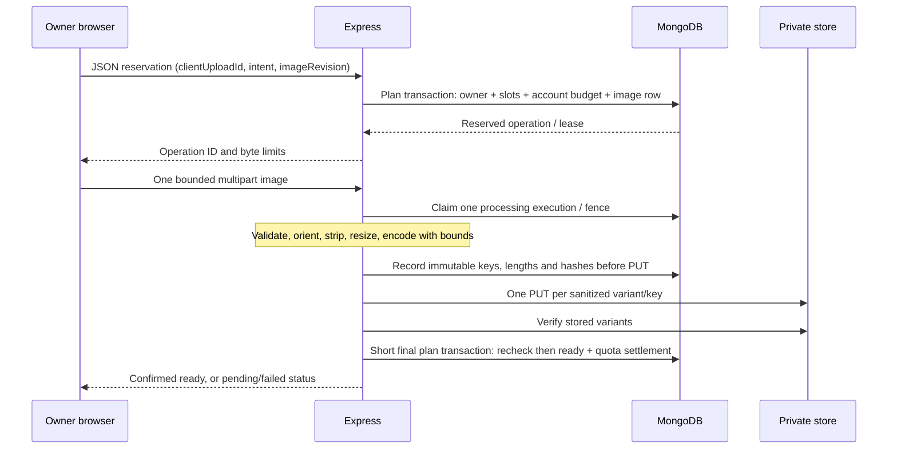
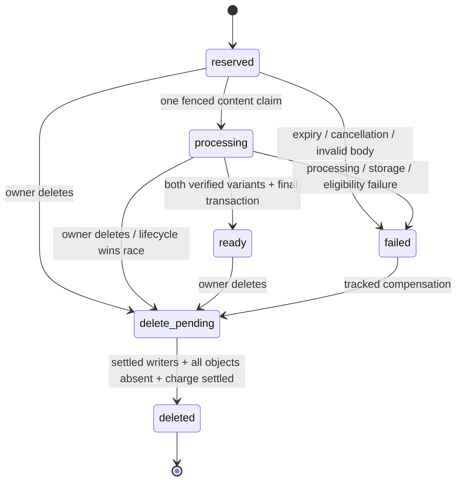

# Milestone 6.5 — Photo privacy, quotas and lifecycle

**Proposal only; no implementation or deletion authority.** Read the
[repository architecture, API/model and source references](milestone-6.5-photo-architecture.md)
and [implementation/test roadmap](milestone-6.5-implementation-roadmap.md).
All thresholds except the approved five-photo maximum are proposed starting
values, to be reviewed with implementation/measurement. R2 remains private;
The owner-approved B1 amendment replaces local MinIO with **disposable
SeaweedFS for local development/CI only**. MinIO remains banned; private R2
remains the future production provider. The [restricted artifact profile](milestone-6.5b1-seaweedfs-review.md)
does not change any image authorization, quota, processing or deletion rule.

## Authorization policy

Use authoritative current records, not a copied `isPublic` flag, supplied owner
ID, signed object URL or old participant role. A readable image must be ready,
have both verified variant records, match its item/plan/owner, match the configured
storage binding and have an existing owner account. Invalid IDs/state/reference
types fail closed. This adds a conservative media check without changing the
existing text listing or closed-message policy.

An authenticated owner can read their existing images on draft, posted, hidden,
expired or cleared inventory, including inactive plans, while the canonical
ownership chain remains valid. Others get access **only while the item satisfies
the existing public-detail eligibility** (published available state, active plan,
valid current UTC window/ownership). The feed's reservation exclusion does not
apply to direct detail: a reserved but still-public listing is already publicly
viewable in current `discovery.detail`.

No special post-withdrawal or post-completion participant grant is proposed.
Withdrawal already invalidates affected requests; do not work around that by
granting indefinite image access. A closed conversation's read-only **text**
history stays readable under its stricter original-participant checks, but photos
are not copied into it. If a later product decision needs a restricted photo
grace period, it requires its own policy/API/revocation tests, not an inference
from message history.

| Viewer / current state | Read | Mutation / explanation |
| --- | --- | --- |
| Owner of valid draft/unlisted item | Yes, authenticated image proxy | Add when plan active; reorder ready images; delete. Never expose draft metadata via public item/feed DTO |
| Anonymous or authenticated non-owner, eligible posted item | Yes | Sanitized ready variants only; no owner/store identifiers or upload metadata |
| Accepted requester, reserved but eligible public detail | Yes, on the same public basis as other visitors | Cannot upload/reorder/delete; reservation grants no extra file permission |
| Original participants after withdrawal/plan deactivation | Owner only | Requester loses photo access even though closed text history may remain readable |
| Cancelled/declined/no-show requester, item still publicly eligible | Same as any public visitor | Terminal request is not a permanent photo entitlement |
| Cancelled/declined requester, hidden/draft/expired/cleared item | Owner only | Old request and known image ID do not authorize a read |
| Completed pickup request / verified handoff | Owner only for the now-cleared item | No new uploads to cleared item; owner may reorder/delete retained images. No automatic 30-day deletion |
| Manually cleared inventory | Owner only | No inference of physical collection/completion or retention clock |
| Expired item or inactive plan | Owner only | New public reads denied; owner can remove photos. Re-publication uses current item rules |
| Reopened item | Owner only until separately published and public-eligible | Existing images stay owned; old requests remain closed. Future public access follows current publication, not old request status |
| Missing user/item/plan/image, ownership mismatch or corrupt binding/state | No | Generic 404 without filenames, owner IDs, keys or private history |
| Invalid/expired session | Public images remain anonymous-readable; private images denied | Matches existing optionalAuth behavior for public reads; private JSON routes return 401/clear cookie. An invalid cookie never becomes owner access |
| Deleted/delete-pending/failed/processing image | No | Pending upload is visible only as safe owner operation status, not an image URL |
| Old app image URL after withdrawal/delete | Fresh authorization denies it | No bucket redirect or long-lived grant; already downloaded/rendered/copied bytes cannot be recalled |

Image proxy: authorize in a short consistent read; fetch bounded bytes outside
the transaction; check expected hash/size; recheck current access/generation/state
before responding. Never keep a DB transaction open over storage I/O. Concurrent
revocation after the final check cannot retract an in-flight response; be honest
about that window and copies already displayed/saved.

Send fixed `Content-Type: image/webp`, exact bounded length, generic inline
filename, `X-Content-Type-Options: nosniff`, `Cache-Control: private, no-store`,
`Referrer-Policy: no-referrer` and a restrictive cross-origin resource policy.
Separate-port local development uses explicit credentialed image CORS against
the configured API (see architecture), not wildcard public/private image access.
Do not forward caller cookies, authorization/bypass headers or arbitrary response
headers to/from storage. Never log image bytes, user IDs, captions, filenames,
EXIF, hashes, keys, signed URLs or provider bodies; use allowlisted phase/category,
status, random request ID and aggregate counts.

### Why not browser-visible signed downloads initially?

R2 presigned URLs are reusable bearer capabilities (documented 1 second–7 days)
and contain object paths. Logout, session expiry, withdrawal or DB deletion does
not revoke an already issued URL; a cached copy can outlive expiry. They work on
the R2 S3 domain, not a custom domain. Physical deletion blocks new origin reads
only after success; custom-domain caches can continue serving deleted bytes.

The same-origin proxy avoids exposing keys and rechecks current authorization on
each new request. No signed URL appears in a public DTO/DOM, redirect, referrer,
trace, screenshot or log. It costs API/DB/transfer work, as quantified in the
architecture. If signed downloads are later approved, use short leases, never
public caching, bounded manual URL refresh after reauthorization, and explicitly
accept key exposure and revocation delay. That is a changed contract, not an
unimplemented invisible requirement of the initial proxy UI.

## Proposed input/resource envelope

| Bound | Initial proposal | Enforcement |
| --- | --- | --- |
| Per item | **5** active photos, including reserved/processing slots | Plan transaction counts ready + active reservations; deleted/failed rows cannot finalize |
| Compressed file | 3 MiB (3,145,728 bytes) | Both reservation and actual streamed bytes; Content-Length/browser compression alone is insufficient |
| Whole multipart | 3.25 MiB (3,407,872 bytes), one file, no extra form fields | Count actual bytes; bounded headers/parts; reject early and stop parser/stream |
| Decoded input | 16,000,000 pixels; each axis ≤10,000; static 8-bit raster, 1–4 channels | Full content/container validation plus Sharp dimensions/pages/depth checks and native decode limit; no unlimited loader |
| Output | Longest edge ≤400/1280, preserve aspect/no enlargement; WebP | Orient then resize; output dimensions stored from actual encoder result, not client metadata |
| Encoded bytes | Thumbnail ≤256 KiB; display ≤1 MiB; combined ≤1.25 MiB | Count encoder output; abort over limit before any object PUT |
| Daily attempts | 50 new reservations/account/UTC day | Each reservation grants at most one processing execution; abandoned/rejected files consume the attempt. Same-operation status/replay cannot reprocess |
| Daily successful images | 20/account/UTC day, including held-success capacity | Reserve a success slot before bytes; convert once at ready; delete does not refund successful count |
| Account retained storage | 100 MiB across items and retained closed media | Actual ready bytes + worst-case reserved/uncertain bytes; physical cleanup confirmation required before release |
| Retained operation records | 1,000/account, including failed/deleted tombstones | Atomic reservation-time count prevents unlimited MongoDB metadata churn; ordinary delete does not free this cap. Reaching it needs operator review/approved metadata policy, not a misleading timed retry |
| Account concurrency | 2 reserved/processing uploads across sessions/instances | Persisted in account usage; no per-process-only quota or blind expiry refund |
| Native work | 1 admitted pipeline per warm instance; Sharp concurrency 1, small bounded cache | Acquire before accepting/decoding body; busy returns bounded retry guidance, no in-memory server queue |
| Variant reads | 8 in-flight/warm instance, each ≤1 MiB buffered/verified | Reject excess work instead of queueing unbounded responses; abort oversized/slow upstream reads |
| IP attempts | 20 upload/control attempts/minute per instance; public media reads separately bounded | Existing express-rate-limit vocabulary, before expensive session lookup. Not a global rate/anti-Sybil guarantee |
| Deadlines | Intake 10s; native timeout per pipeline with total decode/encode budget; each storage call 5s; 40s server/45s client target | Absolute budget and aborts, leases 120s max; availability/peak memory and actual hosting limits must be measured |

Counters use MongoDB server `$$NOW`, not the device or a function clock. Day
means UTC allocation day. No changing threshold through an owner-facing payload.
Server hard ceilings remain even if configured values are invalid; reject bad
configuration instead of interpreting zero/negative as unlimited. Quota values
are reviewable configuration proposals, not a claim of measured capacity.

### Trusted processing sequence

1. Preserve exact Origin + CSRF header and session checks. Accept multipart only
   on the exact registered PUT-content route; all other APIs keep JSON/32kb limits.
   Validate canonical ownership and reserved operation before body parsing.
   Reject non-identity HTTP Content-Encoding; do not add a decompression layer
   that lets the wire-byte limit conceal an unbounded expanded request.
2. Sniff supported bytes and validate the **complete container** with bounded
   parsing. Allow JPEG, PNG and WebP only; reject SVG/XML, GIF, PDF, TIFF, HEIC/
   HEIF, executables, multiple files, truncated streams, inconsistent MIME/signature,
   invalid lengths/chunks and known polyglot/trailing concatenations. Ignore the
   extension/claimed MIME as authority. Multipart sends a generic filename.
3. Check image metadata before full decode: valid nonzero dimensions, channel/
   depth/pixel limits and one frame. Reject APNG/WebP animation explicitly;
   `animated:false` or taking the first page is not an animation detector.
4. Sharp uses explicit `limitInputPixels:16000000`, `failOn:'warning'`,
   `unlimited:false`, sequential read, bounded cache/concurrency and processing
   timeouts. Apply `.autoOrient()` before resize; process the two variants
   sequentially, preserve aspect ratio and do not enlarge. Start with WebP quality
   80/effort 4, subject to measured readability/latency. No recursive recompression
   loop or unlimited output buffers/queues.
5. Re-encode only fresh WebP. Default Sharp output strips metadata; never call
   keepMetadata/withMetadata/keepExif or copy EXIF/IPTC/XMP/ICC/comments. Normalize
   color to sRGB without attaching source metadata. Verify orientation on all
   EXIF values, expected dimensions and metadata absence in **both output files**.
6. Validate output bytes/type/hash, journal exact sanitized variant intents, then
   PUT only those variants to private storage. Original compressed/decoded data
   stays bounded in request memory and is released on success/abort; no original
   or temp file is written into Git, MongoDB, browser storage or object storage.
7. Verify both outputs and short final eligibility transaction before ready.
   Until then there is no public metadata/image URL. Failures use safe categories,
   not raw decoder/provider messages containing filenames or input details.

Magic bytes or successful Sharp decoding alone do **not** prove an input is safe
or non-polyglot. The malformed-media corpus must include JPEG/PDF concatenations,
SVG/script disguises, RIFF/trailing payloads and ancillary-chunk abuse. Strict
envelope validation rejects supported detectable cases; no scanner can honestly
guarantee every imaginable polyglot. The additional security boundary is that
**original bytes are never served and only bounded re-encoded WebP is stored**.
If strict container validation cannot be implemented/reviewed, block that input
format rather than claim the decoder rejects all polyglots.

Sharp's input-pixel limit relies on header dimensions, and its native timeout
does not include libuv wait time. This is defense in depth, not a hard process
sandbox. Benchmark hostile/worst valid inputs and decoder versions before enabling
hosting; a JavaScript timeout does not kill native work. No HEIF loader, antivirus
service, AI classifier, video or processing worker is introduced by this plan.

HEIC/HEIF remains unsupported even if one developer's libvips can decode it.
Safari/iOS picker behavior varies; `accept`/a browser preview does not guarantee
JPEG conversion. C1 accepts supported local sources up to 20 MiB/48 MP/10,000px per edge and
re-encodes a new derivative of at most 1280px/3 MiB before any reservation or
transfer. The original is never a fallback upload. The backend still enforces
3 MiB (3,145,728 bytes) and authoritative Sharp validation. Photo tips explains
both limits; actionable errors direct HEIC export or resizing. Canvas/native
decoder support and device-memory limits vary; no promise covers every phone
photo. No HEIC conversion dependency is added. See [C1 preparation and browser
limitations](milestone-6.5c1-owner-photo-upload.md#local-browser-preparation).

Future UI privacy warning: **“Check photos for visible addresses, delivery labels,
documents and people. Remove identifying details and get permission before
uploading. Removing metadata does not hide what is visible in the photo.”**
EXIF/GPS removal must never be marketed as visual redaction or an address-safety
guarantee; no automatic location extraction or region inference is permitted.

## Transactional reservations and idempotency

- Reservation transaction checks the live item/plan/owner, active slots and account
  usage/retained-operation cap; increments the retained-operation count and
  non-refundable daily attempt, holds one successful-upload
  slot, 1.25 MiB worst-case bytes and one concurrent lease. Insert image row and
  charge atomically. A unique clientUploadId per item plus intent comparison makes
  an uncertain reservation recoverable without duplicate completed images.
  Usage lives in `users.itemImageQuota`; do not upsert a missing user or reuse
  message allowance fields. Explicit auth/profile serializers exclude it. Tests
  must prove profile edits preserve both quota families and neither leaks.
- Generate stable operation IDs/generations before the retriable callback. All
  callback work is metadata-only. Cross-plan account quota contention causes
  ordinary MongoDB write conflict/retry; no two functions can both consume the
  last byte/slot. A per-instance semaphore is only a CPU guard, never quota truth.
- Content intake CAS allows exactly one worker to enter processing. Duplicate
  requests return status without another decode/PUT; changed bytes/hash fail.
  The file's actual server hash must match its reserved intent. Completed or
  deleted clientUploadIds are never repurposed as fresh uploads.
  A busy native processor rejects **before** claiming execution; explicit status
  can confirm the ticket is still reserved before a manual same-intent retry.
  Do not content-deduplicate across accounts or expose another owner's hash/file
  existence. A matching clientUploadId is the only replay identity.
- Ready transaction rechecks references, allowed item state, lease/fence and
  confirmed outputs. Release unused byte reservation, account actual retained
  bytes, convert held success to daily success, release upload concurrency and
  append ready order/increment imageRevision **exactly once**.
- Validation failure before object I/O can release held success/bytes/concurrency
  immediately in an atomic charge settlement; the daily attempt stays consumed.
  After partial/unknown I/O, keep conservative byte/concurrency holds until the
  producer is fenced/stopped and cleanup is safe. Delete/reupload never refunds
  daily success or attempts. No returned 202 claims successful completion.
- Leases end at the earlier of 120s or the next UTC day boundary. Finalization
  must be authorized before that expiry on MongoDB server time. Rotate daily
  counters without subtracting old-day held-success credits from the new day;
  expired old operations cannot commit success in the new quota day. Global byte/
  concurrency holds survive day rollover until safe settlement. Test midnight
  races and transaction retries, not just a mocked browser clock.
- Expiry alone is not proof that a function or provider PUT stopped. Maintenance
  fencing prevents metadata finalization; it does not cancel a remote write.
  Indeterminate cleanup may temporarily block account capacity. Report pending
  cleanup honestly; never “fix” it by dropping the ledger or refunding bytes early.
  On the next owner write/admission, a bounded metadata-only reap (at most the
  two held upload leases) may settle expired **never-claimed reserved** operations
  proven to have no object I/O. CAS the state/expiry and charge exactly once;
  expired tickets cannot start processing. This avoids requiring an operator for
  an ordinary abandoned pre-upload ticket. Processing/unknown PUTs are excluded
  and still require the durable recovery path, not a blind timeout refund.

Use only bounded retry-after values for 429s. IP/per-process limits are not global
limits; multiple accounts can multiply quotas. Durable production abuse/client-IP
policy, account verification, moderation/reporting and global spending controls
remain the existing launch decisions, not a promise that these caps solve abuse.

## Image state machine and failure outcomes

Never move a terminal failed/deleted operation back to ready. Retrying uses an
explicit new reservation after inspecting the old operation; not an automatic
POST replay. Known failure with no object writes can take the cleanup transition
immediately. Unknown outcomes remain pending. Store only bounded failure codes
and retry counters, not decoder text or unbounded histories.

| Failure / race | Required behavior |
| --- | --- |
| Unauthorized/invalid CSRF | Reject before media parsing; no capacity/photo/object write |
| Oversize/unsupported/decode bomb | 413/415/400 category; no original stored; keep daily attempt consumed once reserved |
| Thumbnail PUT succeeds, display fails | Never ready; journal both intents; compensate the settled first object and track any ambiguous second |
| Both objects succeed, final DB commit fails/response lost | Inspect canonical operation/charge; if still eligible and valid lease, recover from journaled verified variants; otherwise cleanup. No second processing cycle |
| Owner deletes while upload runs | Logical removal + state/fence wins; late worker cannot ready. Exact key intents remain for compensation |
| Reorder vs delete/upload completion | imageRevision and exact ready-ID set; one canonical result or 409. No lost cover/current image, no object renaming |
| Clear/handoff/plan closure during processing | Existing lifecycle transaction wins serialization; failed final eligibility cleans new variants. No reopening or new request cancellation rule |
| Storage outage/deletion timeout | 202/pending or 503; preserve retry metadata and charges, never pretend physical removal succeeded |
| Object externally missing/modified | Hash/size mismatch or missing variant never served as valid; read does not repair. Guarded reconciliation reports/marks unavailable and cleans surviving known objects |
| Session expires/old account response arrives | Hide old private images/previews and discard late scope results; no file send retry into a different account |
| Item/plan deleted or corrupt | Deny image reads; keep orphan ledger. Operator-only manifest/target-verified cleanup may remove only validated derived keys, not arbitrary referenced objects |

## Physical deletion and reconciliation

Owner delete transaction first removes the image from ready order and increments
imageRevision. Retain the image row and its complete key/outcome/charge ledger.
Return cleanup pending. A small best-effort same-request delete may reduce delay,
but **do not rely on work after the Vercel response or process memory**. A bounded
manual maintenance command is required for recovery from killed functions/outages.
No cron, worker or scheduled hosted cleanup is activated by 6.5A.

Proposed future maintenance tool: separate **dry-run** and **apply**, DB target/
environment/fingerprint plus storage target/namespace/receipt confirmation, exact
reviewed manifest hash, ≤25 image operations or ≤100 object inspections per run,
bounded cursor/deadline, CAS cleanup lease and persisted backoff. These are design
requirements, **not existing executable commands**. No bucket-wide deletes or
provider lifecycle rules. Use distinct nonsecret storage binding alongside the
existing MongoDB fingerprint; do not reinterpret `E2E_CONFIRM_TARGET` as storage
approval or change hosted cleanup limits.

Critical R2 consistency detail: a 404 after an unknown PUT means absent **at that
instant**, not that the in-flight PUT failed. Never release accounting/delete
metadata solely because of a negative HEAD after timeout. The initial design
issues **one PUT per unique generation key**, with SDK mutation retries disabled.
An acknowledgement, definitive no-write rejection, or a positive HEAD/GET with
the journaled size/hash can settle that one operation. No later worker is allowed
to PUT that key again. Unknown-and-still-absent stays unknown; retain the charge/
ledger and surface operator intervention rather than invent a grace period that
proves failure. This is an availability trade-off, not an eventual-delete SLA.

After all producers are fenced and each PUT outcome is settled, delete every
known variant/temporary key, verify absence (not 403/bucket missing), then atomically
settle account usage and mark deleted. If the DB update fails after physical
deletion, the next run repeats deletion/checks safely and settles the charge only
once. Do not delete objects while an unknown creator can still commit behind the
delete. Keep tombstone/key-generation evidence for later orphan reconciliation;
metadata erasure policy needs approval, never a TTL shortcut.

Bounded namespace reconciliation compares known rows/charges with storage, using
persisted cursors and count-only logs. Missing DB rows/unknown objects require a
separately reviewed owned-key manifest, not automatic deletion based on a prefix
guess. Recompute keys from valid immutable image ID/generation/target binding;
reject mismatches/path traversal/foreign namespaces. A missing parent never grants
public access. An operator can clean a verified orphan without restoring/guessing
the parent's permissions, but cannot use an arbitrary corrupt key as delete input.

Initial server-mediated uploads store **no original/quarantine object**, so there
is nothing unsanitized to retain. If a future direct-upload design is approved,
its original object and any multipart-upload IDs must join the same durable
ledger/settlement process, with explicit private size/expiry/cleanup controls.
Lifecycle/TTL alone cannot perform or prove object-store cleanup.

### Retention, backups and erasure boundary

Verified physical completion is distinct from accepted reservation, manual clear,
plan deadline and arbitrary updatedAt. **Thirty-day post-handoff retention is
documentation only**: no ready-image retentionDueAt, timer, TTL, scheduled job or
automatic deletion is enabled in 6.5A, and later implementation must not enforce it
without explicit owner approval. Existing ready photos remain private to owners
and charged until owner deletion/another separately approved policy.

An R2 bucket is not a tested backup/recovery procedure. Define DB/object manifest
backups, encrypted storage, retention, deletion ledger and isolated restore
verification before launch. Restoring old metadata must not republish deleted
photos; do not restore sessions or overwrite current live data automatically.
Recovery may expose missing objects until reconciled. No backup export, object
versioning, delete retention, restoration or production erasure occurs here.
