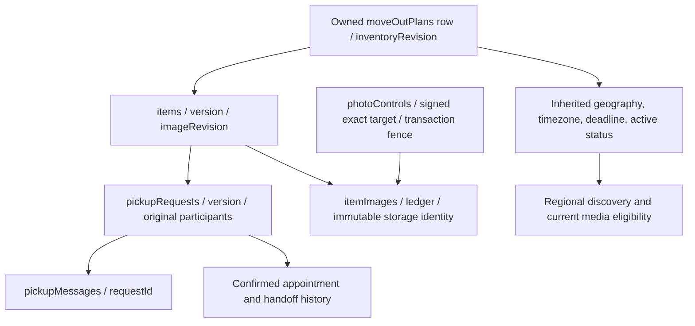

# Milestone 6.6 UX-2A — Item-first architecture and migration design

Status: **proposal for owner review; not implemented or approved for execution**.
Baseline: PR #76 merged on 2026-10-31, main
`f7940024251c5bae09560ae9fd2580aaba558791`. Working tree was clean before
creating `codex/m66-ux2a-item-first-architecture` from fetched main.

This document specifies UX-2B/UX-2C. It changes no runtime, schema, index, data,
feature gate or provider configuration. No database inspection against Atlas,
real R2, hosted verification or migration has occurred. Code findings below are
static observations; future safety properties require the acceptance tests below.

## 1. Current architecture: evidence and dependency map

The [UX-1 dependency report](milestone-6.6-ux1-item-centered.md),
[rescheduling contract](milestone-6.2-rescheduling.md),
[communication policy](milestone-6.2-communication.md),
[B4 recovery](milestone-6.5b4-photo-recovery.md),
[F4 distributed control](milestone-6.5f4-distributed-photo-control.md),
[F5 restore acceptance](milestone-6.5f5-coordinated-recovery.md), and
[D2 media matrix](milestone-6.5d2-pickup-photos.md) describe contracts that a new
listing architecture must retain, rather than replace with client-side checks.

| Source (relative to repository root) | Actual dependency | Essential invariant versus replaceable coupling |
| --- | --- | --- |
| `giftlink-backend/services/inventory.js` | `planTransaction` reads an owned plan and increments its `inventoryRevision` in a snapshot/majority transaction; item create/mutate filters bind `planId` and `ownerId`. `completedHandoff` validates the completed request, first/last history events and plan owner. | Ownership, serialization and verified handoff are essential. A shared move-out plan as the mutex/parent is architectural coupling. |
| `services/plans.js` (backend) | Plan edits inspect children, validate end-date overrides, expire items, cancel affected requests and invalidate proposals with confirmation. | Atomic consequential edits are essential; letting a parent change several listings implicitly is not required for item-first listings. |
| `services/discovery.js` | Regional query begins with eligible plans, joins their owned items, applies publication/window/reservation conditions, then exact totals/cursors. Public DTO location/zone/deadline comes from the plan. | Regional isolation, exact totals, stable sorting and eligibility are essential. Plan-rooted aggregation is replaceable. |
| `services/pickup-policy.js`, `pickups.js` | Request holds `itemId`, `planId`, giver/receiver IDs, version, original-participant history, appointment and proposal. Acceptance, cancellation, handoff and rescheduling use the plan transaction. | Original participants, one accepted request/item, appointment validity and atomic transitions remain essential. Plan ID in a new request should not be required. |
| `services/pickup-communication.js` | New sends use the plan transaction; reference checks verify item/plan ownership. Closed history has distinct original-participant rules. | Canonical conversation ID is still `pickupRequests._id`. Historical text permission must stay separate from permission to send or read media. |
| `services/item-images.js`, `item-image-policy.js`, `item-image-format.js` | Image rows/tickets bind owner, plan, item, generation, immutable identity and storage binding; revisions and quota settlement use transactional checks. | Immutable identity, quotas, leases, admission fences and idempotency are essential. Requiring a plan on every new photo operation is coupling, but cannot be removed from old receipts. |
| `services/item-image-delivery.js`, `public-item-media.js`, `pickup-item-media.js` | Delivery and bounded summaries revalidate owner/item/plan, account existence and public eligibility. Request participation does not grant permanent media access. | Live authorization/revocation and private buckets remain essential; a mandatory plan join for an independent item is replaceable. |
| `services/item-image-recovery.js`, `photo-control.js`, R2 approval/storage modules | Cleanup verifies ledger identity, ownership, generation and signed exact target. Shared control fences upload claims; restore cannot establish permanent revocation under restored old trust. | All target/signature/lease/unknown-write protections remain. Parent migration must not manufacture ownership, absence or a quota refund. |
| `routes/itemRoutes.js`, `itemImageRoutes.js`, `planRoutes.js`, `pickupRoutes.js` | Owner item/media mutations are plan-scoped. Public item URLs and pickup IDs already provide stable identities. UX-1 edit-context resolves an owned item's plan. | Auth, CSRF, field validation, versions and resource bounds stay; plan-scoped entry points become legacy adapters. |
| `giftlink-frontend/src/App.js`, `Inventory/*`, `MoveOutPlans/*`, `Journeys/*`, `api/itemImages.js` | Create lives at `/app/plans/:planId/items`; editor, upload root, timezone and deadline depend on parent data. My Plans/Give Away guide creation. | One submit intent, independent drafts, explicit loss protection and uncertain-response recovery stay; navigation and form parent dependencies change. |

Backend paths abbreviated to `services/...` and `routes/...` above are under
`giftlink-backend/`. Inspecting a field reference is not proof that deleting it is safe.



### Inherited fields and current stored state

Items store their own name, description, legacy `category`, canonical classification,
condition, `availableFrom`, optional `availableUntil`, stored status, publication
requirements marker, timestamps, versions and photo revision. They inherit
`stateId`, `metroId`, `city`, `neighborhood`, `pickupTimeZone`, the fallback end date
`plan.moveOutDeadline` and the parent active/inactive gate. Their effective end is
`item.availableUntil || plan.moveOutDeadline`, capped by that plan deadline.
Expiration of `available` may be derived on read; do not assume a scheduler has
written `expired` to every old row. Existing publication can precede a future
pickup start. Metro browsing requires additional region/timezone eligibility;
this must not be mistaken for a change in publication semantics.

### Collections, indexes and fixtures

`services/database-indexes.js` defines 16 application indexes: user email unique,
session TTL; plan owner/deadline and plan metro discovery; item plan/owner,
publication and pickup-start; request received/sent, unique accepted `itemId`,
unique active `(itemId,receiverId)`; message `(requestId,createdAt,_id)`; four image
indexes for item/state/order, unique `(itemId,clientUploadId)`, due maintenance and
owner/state. `photoControls` additionally relies on its native `_id` identity and
explicit initialization. Preserve these; do not drop a plan index while legacy
paths still use it. `users`, `sessions` and their security contracts do not need a
model migration. The separate legacy gifts collection/import endpoints and the
16 bundled `util/import-mongo/gifts.json` records stay unchanged.

Tests in `test/{items,plans,regional-discovery,pickups,pickup-communication,rescheduling,item-images}.test.js`,
the image processing/recovery/control/restore suites, and `e2e/{workflow,listing-inventory,owner-photo-upload,owner-photo-management,public-item-photos,pickup-item-photos}.spec.cjs`
construct plans today. Add independent-item fixtures alongside them; do not
replace all fixtures and thereby erase legacy-path coverage. F5's eight-collection
snapshot allowlist includes plans and image ledgers; its consistency checks must
understand both models before any new-format restore is accepted.

## 2. Alternatives and recommendation

| Approach | Benefit | Cost / risk | Decision |
| --- | --- | --- | --- |
| A: hidden plan per listing, existing items remain plan-owned | Reuses most transaction and media code initially; no separate plan screen. | Duplicates location/status/deadline authorities, makes hidden plan ownership permanent, retains child/parent mismatches and restore complexity. A shared hidden plan cannot support different locations/deadlines independently. | Reject as the destination. Do not silently generate dummy plans as an implementation shortcut. |
| B: versioned independent items; explicit legacy resolver and staged adapters | Each listing owns its context; stable item/request/image IDs remain; no new mandatory collection. | Requires every transaction/media/history consumer to understand the discriminated model and careful mixed-version deployment. | **Recommend**, with legacy records retained until an approved migration can detach them safely. |

Recommendation is B, not a wholesale rewrite or immediate removal of `moveOutPlans`.
New listings use an explicit new schema; old listings continue their old semantics
until deliberately converted. No implicit field-by-field fallback from a damaged
new item to a plan. Optional future grouping is outside this proposal.

## 3. Concrete target model (proposed, not current)

Keep the `items` collection. Introduce `listingSchemaVersion: 2` as an explicit
model discriminator (absence means legacy v1, not corrupt v2). Representative
BSON/document fields:

| Field | Definition / validation / exposure |
| --- | --- |
| `_id`, `ownerId` | Preserve ObjectId item identity; derive owner from validated session only. Never accept owner assignment in a client body or expose account IDs publicly. |
| `listingSchemaVersion` | Server-set integer `2`; immutable except through an approved conversion transaction. Reject unsupported versions. |
| `name`, `description` | Existing bounded plain-text and publication policy; name-only drafts stay possible. Description required for publish. |
| `categoryId`, `itemTypeId`, `customItemType`, `condition`, `category` | Preserve canonical IDs, relationship validation and optional sanitized custom Other. Preserve legacy category text without rewriting it. Category is derived from the explicitly selected type in the UI. |
| `stateId`, `metroId` | Item-owned canonical IDs validated together against the pinned directory, including cross-state membership. Both required for a newly published v2 listing; draft may leave them absent. |
| `city`, `neighborhood` | Optional normalized bounded display labels, empty string when unspecified; never an address field. Proposed maximum 100 Unicode code points each, plain text, no controls/markup/contact data. Final validation must reuse/audit existing region normalizers. |
| `pickupTimeZone` | Explicit valid IANA zone, draft nullable. Required for new v2 publication. Directory suggestion is a visible suggestion requiring explicit confirmation/correction, never a precise inference for ambiguous metros. No account-wide automatic location defaults. |
| `availableFrom` | Nullable `YYYY-MM-DD`, existing UTC-calendar policy and validation; null means immediate pickup availability. |
| `availableUntil` | Item's required pickup deadline on publication, nullable in an incomplete draft. No parent cap/fallback for v2. Preserve current inclusive UTC-date expiration and appointment local-day plus UTC cutoff checks. |
| `status`, `publishedAt` | Keep canonical `draft/available/unlisted/cleared/expired`; publication timestamp remains the original publication instant on republish. Derived labels are specified below. |
| `publicationRequirementsVersion` | Preserve the existing marker for legacy behavior. Specify a reviewed new marker for v2 publication requirements rather than retroactively applying them to old records. |
| `version` | Existing optimistic content/lifecycle version; stale writes return 409. |
| `coordinationRevision` | Proposed server-only monotonic integer used as the per-item transaction write fence; initialize explicitly, never upsert a missing item to acquire it. Distinct from public content and photo revisions. |
| `imageRevision`, `clearedByPickupRequestId` | Existing photo ordering revision and verified-handoff reference, unchanged meanings. Photos/requests reference the same `_id`, not embedded copies. |
| `createdAt`, `updatedAt` | Server-derived BSON Date timestamps serialized as ISO strings. |
| legacy `planId`, conversion provenance | Required and authoritative for v1. Absent for new v2 items. Converted items may retain immutable provenance identifying the source plan/inventoryRevision and conversion digest; this is not an authorization parent or public field. |

Do not require apartment, residential street address, coordinates, HOA or tenancy
proof. Plain-text checks cannot guarantee detection of every residential address:
labels have privacy guidance, bounded validation and owner withdrawal; do not
claim complete automatic PII detection. Public DTOs allowlist general location,
item fields, eligibility flags and safe application media summaries only.

Draft-photo prerequisite proposal: name-only drafts without a deadline remain
valid, and files may be selected/prepared in memory. Saving a draft **with photos**
requires an explicit valid item deadline before authorizing binary intake, retaining
the current admission requirement for a live valid pickup end. Surface that field
error before saving/uploading; do not invent a plan deadline, silently upload an
unbounded draft or discard staged files. Draft photo intake need not require a
metro/timezone where the existing admission contract does not. This UX trade-off
requires owner approval alongside publication prerequisites; navigation/reload loss
protection remains necessary because staged files are not persistent drafts.

An internal `resolveListingContext` contract should return a validated owner,
effective location/zone/window/publication gate, model kind and fence strategy.
V1 requires matching owned item **and plan**, and preserves all inheritance.
V2 requires complete item-owned context when publication is involved and never
consults provenance as fallback. Missing/compromised references deny access, not
repair themselves. Share policy resolution across discovery, pickup and media;
use equivalent aggregation predicates for bounded queries, not per-card service
calls or downloading all listings for client filtering.

## 4. Transactions, media and history: non-negotiable contracts

### Mixed-model coordination

Every participating mutation must write the same authoritative fence for its
item. For v2, snapshot/majority transactions increment `coordinationRevision` on
an existing owned item and include all affected request/history/quota/control
writes. A request version, unique indexes, or read-only snapshot alone does not
prevent publication-versus-acceptance write skew.

For legacy items during rollout, retain the plan fence and introduce the item
fence in a fixed **plan then item** lock order where needed. Do not allow an old
writer that touches only a plan to race a detached v2 writer that touches only an
item. Before any conversion, drain old workers and deploy the compatibility
release to all instances, CLI/recovery workers and old route adapters. Conversion
must touch both fences and compare the exact item/plan preimage. Retry MongoDB
transaction conflicts using existing bounded semantics, not external PUTs.
Photo admissions must still conflict on F4's shared control record in that same
transaction. Pause prevents new durable claims; committed permits may finish.
No claim of permanent key revocation under database-and-trust rollback is added.

### Requests and messages

Keep request IDs and `pickupMessages.requestId`. New requests need a versioned
reference format, e.g. `referenceVersion: 2`, item/giver/receiver IDs and immutable
creation/history binding; no fabricated `planId`. Old rows without this version
must continue to satisfy the original four-ID/first-event checks. Unknown or
mixed reference formats fail closed. Never weaken `originalParticipants` into
merely checking whether the current session matches either stored ID.

For an old request on a converted listing, keep its original `planId` and history
unchanged. Its legacy plan and original participants must remain verifiable even
though the listing now uses item-owned live availability. This needs an explicit
verified conversion relationship, not relaxed equality checks. Lost/corrupt
legacy plans do not gain an automatic recovery bypass. New appointments snapshot
UTC instant, original wall time and IANA zone exactly as today. Migration never
reinterprets or recomputes historical appointments. Version/proposal-ID guards,
future appointment checks, reject-on-DST-gap/fold, other-participant acceptance,
proposal invalidation and transactional cancellation/handoff remain.

Terminal text history remains readable to permitted original participants under
the existing integrity policy; deleted/compromised references never grant access.
Closed requests cannot send. Chat is not an appointment editor or a separate
conversation system. Shared message quotas, bounded cursors and no automatic
POST replay remain.

### Photo formats and cleanup

Do **not** edit old image rows, storage keys, generations, hashes, signed receipts,
operation IDs, tombstones or quota ledgers to remove their `planId`. Old tickets
and receipt digests are immutable. Add a separately validated new image-operation
schema and ticket/receipt format for independent listings, discriminated by
version, with owner/item/exact database-provider-bucket-prefix-environment binding.
No permissive "planId optional everywhere" change to existing validators.

New item-scoped image routes feed the same sanitization, bounded sequential
upload, five-photo/account/day/lifetime quota, immutable conditional PUT, durable
one-time permit and uncertain-response machinery. Existing image rows continue
through their old-format verifier. Converted items need an explicit compatibility
relationship before old images can be read; an invalid legacy parent still denies
rather than transferring ownership. In-flight operations must be drained or
classified before conversion; unresolved PUT/delete/lease state blocks automatic
conversion. Reads, upload admission and separately approved cleanup remain
independently gated. No new persistent data collection is necessary for the live
model; signed bounded operator manifests are separate private artifacts.

Public card/detail media requires **current** eligible item access; discovery
excludes reservations while detail retains the existing eligible reserved-item
policy. A pending/accepted/closed request does not create private-media rights.
Valid owners may read their own withdrawn media under existing policy; nonowners
lose media access after withdrawal/expiration/deletion. No-store application
URLs, session recheck after storage fetch, no EXIF/GPS/original filename/provider
URL exposure and bounded batch enrichment remain. Logical photo deletion does
not refund quota. Negative HEAD/GET, elapsed time or unreachable storage never
prove an unknown write absent. Cleanup/recovery retains leases, exact target
approvals, receipt verification and exact-once settlement across both schemas.
F5 restore must refuse unknown new schemas until it validates their complete
reference graph. Unsafe restore means full photo outage and fresh independently
approved reauthorization; restoring old trust cannot guarantee permanent revocation.

## 5. Lifecycle and withdrawal

| Stored state / facts | UI label | Allowed meaning |
| --- | --- | --- |
| `draft` | Draft | Private, incomplete item-owned context allowed. |
| `available`, published, live eligible window | Published / Available now or available from date | Future pickup start does not automatically delay publication. |
| One or more pending requests | Pickup requested | Derived owner attention label; not a reservation and not a new item status. |
| Valid accepted request | Pickup arranged / Reserved | Derived from authoritative request data; preserve the unique accepted-item index and conservative blocking of inconsistent accepted references. |
| `cleared` + verified completed handoff chain | Picked up | Only the existing giver-authorized, version-checked legitimate handoff path qualifies. |
| `cleared` without that chain | Cleared | Manually dealt with; never label it a verified pickup. |
| Stored or effectively expired `available` | Expired | Derived UTC deadline eligibility; no automatic destructive state repair on GET. |
| `unlisted` | Withdrawn | Public visibility revoked, legitimate history retained; not completion. |

Design **Withdraw listing** in owner detail and My Listings secondary actions.
Show a confirmation explaining removal from public browsing and any affected
pending/accepted pickups. Server preview returns affected count and current
version; confirmation resubmits the same intent with explicit cancellation consent.
If versions/affected state change, return conflict and require review again.
Atomically withdraw, cancel affected active requests, invalidate proposals and
append reasons/history. Preserve original records and completed handoffs. Recheck
media authorization on subsequent requests and after storage reads. Do not erase
already delivered browser pixels or pretend no-store can recall downloaded bytes.

Keep the existing protected `unlist` primitive until its item-scoped replacement
passes races and privacy tests. Retain its current allowed transitions initially;
withdraw is not a way to reopen completed requests or silently clear inventory.
Republishing follows existing validation and never resurrects cancelled requests.
Location/zone changes cancel active requests with explicit review, rather than
silently moving an appointment. Window changes invalidate only affected confirmed
appointments/proposals according to existing rules. No automatic rescheduling.

## 6. Proposed API and routes

All additions below require later implementation review. Existing auth/session,
CSRF/Origin, bounded body/query validation, quota and error serialization apply.
No request body may select owner, schema version, coordination revision, storage
binding or derived reservation/handoff flags.

| Proposed endpoint | Contract |
| --- | --- |
| `POST /api/items` | Authenticated create; additive POST beside existing public GET. Draft or explicit publish, item-owned location/window. Server returns canonical saved item ID/version and safe photo capabilities. Photos upload only after this save and under the user's single explicit submit authorization. |
| `GET /api/me/items?limit=&cursor=&status=` | Private My Listings, bounded cursor with deterministic `(createdAt,_id)` ordering, model-neutral owner DTO, optional truthful statuses. No per-card metadata calls. |
| `GET /api/items/:id` | Existing public detail eligibility and URL semantics preserved; never expose a private draft here even to owner. |
| `GET /api/me/items/:id` | Private owner detail including drafts/withdrawn/expired, version and capabilities. Owner-only; generic denial for foreign IDs. |
| `PATCH /api/items/:id` | Authenticated owner edit with required version; validate the full resulting context and consequential changes. |
| `POST /api/items/:id/actions` | Existing canonical `publish/unlist/clear/reopen` meanings, required version and explicit cancellation confirmation. UI says Withdraw; avoid a second incompatible `withdraw` state. |
| `PATCH /api/items/:id` availability fields | Availability/deadline/location/zone edits use the same version and reviewed cancellation protocol, not a separate scheduling entity. |
| `/api/items/:id/images/...` | Additive item-scoped metadata/upload/status/delete aliases only after versioned media support; old plan-scoped routes still validate the supplied owned parent. |

Illustrative v2 publish body (not an available endpoint today):

```json
{"name":"Shoe cabinet","description":"Household shoe cabinet.","categoryId":"storage-organization","itemTypeId":"cabinet","stateId":"06","metroId":"31080","city":"","neighborhood":"","pickupTimeZone":"America/Los_Angeles","availableFrom":null,"availableUntil":"2027-11-12","publish":true}
```

Preserve existing response envelopes (`{item:...}`), status/error conventions and
field-associated validation. Missing publish context yields actionable 400 errors;
stale versions/cancellation confirmation yield 409. Owner foreign resources use
generic 404 after authentication; anonymous private access is 401. No idempotency
claim for item creation exists today: retain C1 uncertain-create blocking and
canonical inventory/status inspection; never automatically repeat a create after
an ambiguous response. Any future create-key design needs its own bounded contract.

Frontend proposal: `/app/listings` (My Listings), `/app/listings/new` (Create Listing),
existing `/app/items/:itemId` (public detail), existing `/app/items/:itemId/edit`
(owner editor). Private My Listings cards open `/app/listings/:itemId` for owner
context when not public; published cards may open the normal detail with Edit,
Withdraw and existing request links. Nonowners never receive private capabilities.
Creation publishes to existing public detail; save-draft opens private owner detail.
Keep browse query/region return context, keyboard focus and independent draft
protection through navigation. No detached Photos page or second editor.

Old `/app/plans/...`, plan-scoped APIs and UX-1 edit-context remain functional legacy
paths. New item writers share the canonical service; old plan routes cannot attach
an independent item to an arbitrary plan. During transition, old clients receive a
clear conflict/upgrade path for model-incompatible mutations, never silent success.
Public discovery/request/conversation URLs remain stable.

## 7. Compatibility, migration, indexes and rollback

### Rollout sequence and safety barriers

1. Ship a compatibility release able to **read both** models, validate both reference
   formats and use common mutation fences, with v2 creation/conversion disabled.
   Keep current photo gates disabled and all legacy paths working. Inventory and
   account/session behavior must work during a photo outage.
2. Add proposed indexes through the existing `db:prepare` registry only after
   isolated explain/conflict testing and reviewed dry-run/apply approval. Startup
   verifies required indexes; it never creates them. No remote apply in UX-2A/B CI.
3. Complete UX-2C media/request/recovery support and all dual-model tests before
   enabling new published v2 listings. UX-2B can expose preview/private drafts in
   isolated testing; do not release listings that cannot accept pickups safely.
4. Enable independent creation only by separately reviewed release/config approval.
   Each new listing has its own location/deadline; no hidden plan is inserted.
5. Offer a separate, explicitly approved operator conversion, never startup/lazy
   read migration. Old records need not convert immediately and remain usable.

### Bounded conversion design

An eventual script is needed **only** to detach existing records, not to create
new independent items. It must preview exact target fingerprint/environment,
item versions, plan inventory revisions and context digests in a bounded private manifest; report counts/conflict
categories without private addresses, emails or ledger secrets. Apply requires
explicit operator approval of that exact manifest/fingerprint, supported schema
versions, quiesced old writers and target fencing. Keep resumable stable-ID cursors.

For each item: snapshot the current effective context (including explicit item
end override versus inherited deadline and inactive/public eligibility), validate
owner/plan/request/image graph, and block unknown operations/live leases or
ambiguous references. Missing timezone/region is a conflict requiring an explicit
owner decision; do not guess or upgrade publication requirements on grandfathered
items. An inactive plan must not yield an accidentally public detached item:
require reviewed withdrawal/cancellation or leave it legacy. Expired/completed
items and histories keep their semantics; no conversion resurrects visibility.

Compare-and-set the item version, plan `inventoryRevision` and coordination fences in one transaction;
copy approved effective context into the item, preserve `_id`, `publishedAt`,
classification and completion references, increment content/coordination versions,
and record provenance/digest. Do not rewrite request/message history or photo
operation receipts. An already converted row with the same approved provenance
is a verified no-op; a different digest/version conflicts, never overwrites.
Partial batches leave remaining legacy rows intact. Re-run previews after any
material change. Do not dual-write two competing location/deadline authorities.

Legacy plan edits continue to affect only legacy children. Updating a retained
plan cannot silently change a detached listing. Explicitly reject or clearly
report mixed-plan bulk changes until that behavior is reviewed; no pretend
all-items update. Retain plans referenced by any legacy request/image/restore
artifact or audit/recovery contract. Retirement means removing obsolete UI/write
paths after measured compatibility coverage, not deleting collections. No retention
or physical erasure is approved here.

### Index proposals (not registry changes)

Keep all 16 current indexes and unique request/image constraints. Evaluate an owner
feed index `{ownerId:1,createdAt:-1,_id:-1}` and an independent regional index
`{metroId:1,status:1,stateId:1,publishedAt:-1,_id:-1}` with a partial filter on
`listingSchemaVersion:2`. Select final keys after isolated `explain` for newest,
deadline and combined filters; do not assert one index handles all sorts. Recovery
schema validation may change without changing its due-work index. Never remove
uniqueness constraints or introduce TTL on operation/tombstone history.

During mixed discovery, scope each branch by model and canonical metro membership,
apply equivalent policy/reservation exclusions, combine **before** global sorting,
exact counting and bounded pagination. Count is not the sum of two separately
paginated pages. No unscoped fallback; invalidate incompatible cursor versions
with a clear restart action. Only enrich the final bounded set with media.

### Rollback

Disable new v2 admission/conversion first; drain/fence workers, preserve existing
reads/status and separately authorized cleanup. Roll back to the **dual-model
compatibility release**, not a pre-UX-2 binary: old code cannot safely serve new
planless rows, media tickets or transactions. No deletion, synthetic plan insertion,
quota reset, unknown-PUT replay or reverse rewriting of signed ledgers.

Data reversal would be a new, separately reviewed migration after reconciling all
post-conversion edits and operations; old source snapshots are not a safe inverse.
If compatibility integrity is uncertain, use full photo outage, retain text/auth
where safe, follow F5 quarantine/restore and independently approve trust renewal.
Restoring an older database plus older trust cannot establish permanent revocation.
Preserve additive Microwave/Mirror IDs on UI rollback as documented in UX-1.

## 8. Reviewable implementation sequence

These are proposed PRs, not authorization to begin UX-2B. B/C naming describes
scope; dependent PRs may be stacked but nothing activates before C acceptance.

| PR / dependency | Scope and expected modules | DB / authorization risk | Required tests and acceptance | Rollback |
| --- | --- | --- | --- | --- |
| **B1: dual-model context and fences**, after approved UX-2A | `inventory`, `plans`, `pickup-policy`, `discovery`, serializers; introduce explicit discriminators/resolver and per-item fence while retaining legacy plan locking. No new public create UI yet. | Item fence field initialization is a versioned change; prevent old-writer/new-writer write skew and parent fallback on corrupt v2. | Independent OS workers, legacy plan edit vs item mutation, acceptance/withdraw races, invalid schema/owner; old suite still passes with v2 disabled. | Disable new model; retain compatible resolver/fences; do not restore old workers after v2 data exists. |
| **B2: item-owned APIs and guarded index proposal**, after B1 | `itemRoutes`, inventory service, `database-indexes`, guarded preparation tests; private owner feed/detail, create/edit/publish/withdraw with v2 creation off by default. | Proposed owner/regional indexes need explicit preparation, no startup DDL. Deny owner spoofing, validate optional location labels and explicit timezone. | Isolated native Mongo transactions, wrong-owner 404, stale versions, confirmation races, exact counts/cursors/explain; two different metros/deadlines have no hidden plan. | Gate creation; keep old routes and dual-model readers. |
| **B3: Create Listing / My Listings / owner detail**, after B2 | `App`, `Journeys`, Inventory form/session/API clients, new owner feed, shared RegionSelector. Reuse C1 submit/draft pipeline, add withdrawal confirmation. | No new DB schema beyond B2. Do not expose owner-only DTOs through public detail or overwrite another listing's location via browse preferences. | Keyboard/320/375/desktop, optional city/neighborhood, first listing without plan, two independent locations, validation focus, uncertain create and native/in-app draft loss guards. | Hide new navigation/admission; existing routes remain; keep support for saved v2 drafts. |
| **C1: versioned private media + recovery**, after B1/B2; may stack with B3 | `item-images`, format/policy/intake/delivery/recovery, storage ticket/approval code, photo controls/restore harness, image routes and frontend image client. Preserve old immutable receipts. | New receipt/schema validation is security-critical; old/new cleanup must remain exact-target fenced. Production gates remain off. | Real private SeaweedFS/Sharp, conditional/concurrent/unknown PUT, quotas/tombstones, cover/delete, late workers/pause/revocation, wrong parent/account and restored snapshots. | Stop admission, retain both readers and approved cleanup; outage if integrity uncertain. |
| **C2: requests, chat and scheduling compatibility**, after B1/B2/C1 | `pickups`, `pickup-policy`, communication/media services, existing request/chat/time components and old route adapters. Add explicit reference version; never a second inbox/conversation entity. | Binding original participants and legacy conversion relationships; keep unique accepted-item constraint and cancellation semantics. | Two accounts, pending/accepted/all terminal states, original-participant history, no self-request/self-approval, DST, deadline/location edits, stale proposals, handoff and closure races, no permanent requester photo rights. | Disable new creation; support both historical formats and existing appointments; no downgrade to legacy-only validators. |
| **C3: conversion preview + full acceptance**, after B3/C1/C2 | Separate guarded conversion preview/apply utility, test fixtures, docs/operator runbook, complete browser/policy suites. No remote execution without approval. | Approved manifest/preimage fencing, no automatic schema/index apply or record deletion. Block unresolved operations. | Dry-run no writes; repeat no-op; partial batch/stale manifest; mixed plan writes; full desktop/mobile/axe two-account suite and F5 restore drills; preserve 16 gifts. | Stop conversion; compatibility release remains rollback floor; reconcile before any reversal. |

Merge order: UX-2A → B1 → B2 → B3/C1 in their declared dependency order → C2 → C3.
B3's published workflow cannot activate until C2/C3 are complete. Each PR reports
actual checks, files and gates; no automatic merge, production deployment, index
apply, hosted E2E or real-provider activation is implied by this sequence.

## 9. Acceptance matrix for later implementation

All data tests use disposable local replica sets, verified private SeaweedFS and
synthetic identities; browser checks use actual local HTTPS. These scenarios are
**requirements, not results of UX-2A**.

| Scenario | Automated proof / manual acceptance |
| --- | --- |
| 1. First listing, no plan | Register, open Create Listing, save/publish once; assert zero new plans, exactly one owned item and no repeated create after lost response. |
| 2. Two independent listings | Shoe cabinet in LA with one deadline; second listing in another metro/deadline. Assert separate item fields; changing one does not touch the other/account preference. |
| 3. My Listings | Both records with accurate statuses, bounded pages/cursors and no owner-data crossover. |
| 4. Edit independently | Stable item URL, owner controls, stale version 409, independent text/photos and safe session/navigation behavior. |
| 5. Regional discovery | Correct metro/cross-state/category/search combinations, no other metro fallback, exact totals/sorts/cursors across legacy + v2 and reservations. |
| 6. Request pickup | Correct item and explicit zone/window; reject self-request, invalid dates, stale location and duplicate active requests. |
| 7. Coordinate privately | Canonical request conversation; both original participants, chronological bounded history, uncertain send/quota/draft recovery and no message HTML. |
| 8. Accept/decline | Giver authority, accepted-item exclusivity, future confirmed appointment and legitimate handoff protections under concurrent requests. |
| 9. Photos | New/legacy/converted ownership, ready-only covers, private delivery, revoked access after storage fetch/session expiry, no filenames/EXIF/GPS/provider keys; unknown PUT remains charged. |
| 10. Withdraw | Explicit affected-count confirmation; atomic visibility/photo revocation and request/proposal cancellation, readable permitted history; no false pickup completion or stale URL access. |
| 11. Legacy usability | Existing plan routes, inherited deadline/timezone/region, plan edits and old client contracts remain valid before conversion. |
| 12. Old appointments/history | Preserve IDs, UTC/local/zone snapshots, first/last actor evidence, completed handoff links; closed text read-only and separate photo permission. |
| 13. Cross-account denial | Owner A/B, requester and third user: denied GET/PATCH/actions/images/status/cleanup; forged versions/parent IDs/reference formats never transfer ownership. |
| 14. General location privacy | Optional city/neighborhood; no address/GPS/apartment fields, owner IDs/emails or exact pickup details in public DTOs/logs. Manual content review acknowledges limits of PII detection. |
| Migration/recovery | Bounded dry-run, exact fingerprint and preimage conflicts, repeated/partial conversion, old worker fencing, live leases, unknown writes/tombstones, pause/restore/revocation rollback limitations. |
| Human UX | Desktop, 320/375, 200% reflow, keyboard/error focus, first-click save after type search, cover fallback, no unnecessary plan step; actual screenshots and two browser sessions. Physical Windows/Safari/iOS and screen-reader use require separate human evidence. |

Run all backend/frontend, dependency compatibility, policy, strict build and
isolated HTTPS suites in B/C, keeping original fixtures as well as new ones.
No CI green result alone proves actual R2, hosted Vercel or Atlas readiness.

## 10. Review decisions and blockers

Owner approval is needed for this architecture and the PR boundaries, the proposed
v2 publication requirement (explicit state/metro/timezone/deadline while retaining
legacy exceptions), UTC-date deadline semantics versus a future local-time change,
and the conversion/legacy-plan-edit policy. Recommendation: keep current UTC
semantics, retain unconverted plan inheritance, detach only by approved per-item
manifest, and retain all historical parents/receipts. No erasure policy is proposed.

P0 implementation blockers before v2 publishing: shared transaction fences across
all workers, versioned participant/media/recovery verification, approved indexes
and dual-model discovery correctness, and tested withdrawal/revocation. P1: safe
mixed-client rollout, rollback floor, legacy conversion conflicts and complete
recovery inventory. P2: owner-feed performance tuning, optional grouping later,
real device verification and existing test-navigation stability observations.
Real-provider permission, backups/network durability, dependency security debt
and F4 independent revocation authority remain separate existing launch concerns.

## 11. UX-2A validation record

Performed: merged-PR and clean-tree verification, fetched-main ancestry, source /
route / index-registry / test-fixture inspection, review of the linked architecture
contracts, local Markdown link/section/example validation and committed-diff
whitespace checks. Only this document and a README navigation link are changed.
No app tests, new browser screenshots, Docker fixture execution or live staging
E2E were required to assert a design-only patch; previous UX-1 test totals are not
presented as UX-2A or item-first implementation evidence. Normal repository CI may
run automatically on PR creation and is reported separately in the PR.
